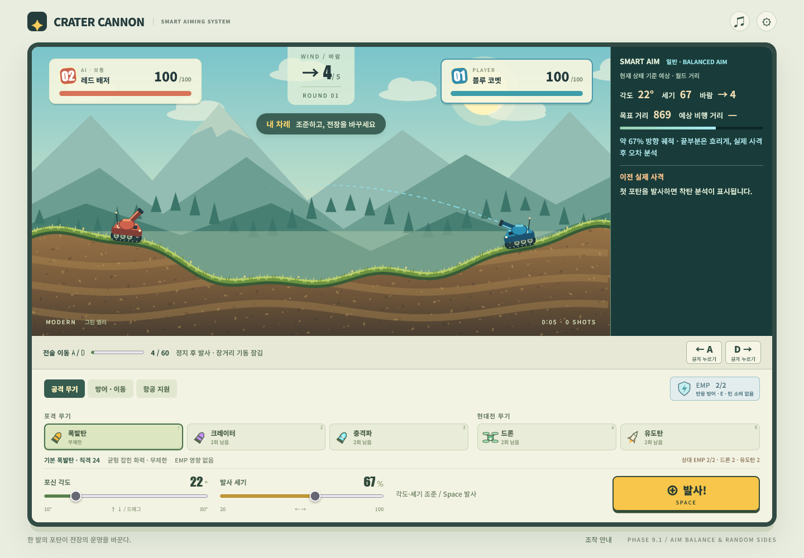

# CRATER CANNON · 크레이터 캐논

> 시대는 바뀌어도, 전장을 바꾸는 것은 한 번의 선택이다.

**Phase 9.1 — AIM BALANCE & RANDOM SIDES · 1.8.1**

React + TypeScript + Canvas 2D로 만든 한국어 싱글 플레이 포격 게임입니다. WWII 3개 임무와 가상의 현대전 5개 임무를 순서대로 진행하거나, 기존 현대전 자유 전투를 플레이할 수 있습니다. 계정·백엔드·유료 API·외부 에셋 요청 없이 실행됩니다.



[Phase 9.1 구현·검증 보고](docs/PHASE9_1.md) · [Phase 9 구현·검증 보고](docs/PHASE9.md) · [Phase 8 호송·보스 기록](docs/PHASE8.md) · [Phase 7 목표 임무 기록](docs/PHASE7.md) · [Phase 6 이동 기록](docs/PHASE6.md) · [Phase 5 캠페인 기록](docs/PHASE5.md) · [Phase 4 기록](docs/PHASE4.md)

## 실행

Node.js 24 권장. Windows에서는 **Start-Game.cmd를 더블클릭**하면 설치 확인 후 브라우저가 열립니다.

```sh
npm ci
npm run dev
```

터미널에 표시되는 로컬 주소를 엽니다. 빌드 결과 `dist/`는 정적 호스팅할 수 있습니다.

```sh
npm test
npm run build
npx playwright install firefox
npm run test:smoke
npm run test:e2e
npm run test:balance
```

E2E는 4187, 프로덕션 스모크는 4188을 사용합니다. 테스트 모드만 읽기 전용 QA 상태와 고정 시드를 제공하며, 프로덕션 빌드는 둘 다 제외합니다. 개발/테스트 서버는 별도의 Vite 의존성 캐시를 사용합니다.

## 스마트 조준과 사격 훈련

- 기본 **일반(BALANCED AIM)**: 실제 물리 경로의 약 67%만 표시하고 끝을 흐리게 합니다. 예상 착탄점·범위·명중 정답·비행 거리 수치는 숨깁니다. 짧은 비행은 안전 간격을 확보하도록 더 일찍 끊습니다.
- 조준 보조는 **일반 / 초보자 / 숙련자 / 끄기**이며 AI 난이도와 독립적입니다. 초보자는 전체 예측, 숙련자는 짧은 방향선입니다. 훈련장은 모든 설정에서 전체 학습 가이드를 유지합니다. 기존 default→balanced, extended→beginner, off→off 설정을 보존합니다.
- 하늘색은 예상 경로, 주황색 십자 “이전 탄”은 직전 실제 착탄 1발입니다. 내부 기록은 최근 3발을 유지하며 HUD에서 실제 각도·세기·바람·오차·충돌 원인을 읽을 수 있습니다.
- 연막은 조준 불확실성을 표시하고 정확한 예측 수치를 숨깁니다. 드론은 수동 조종, 유도탄은 초기 구간만 표시합니다.
- 메인 메뉴 **사격 훈련**: 가까운 A / 먼 B / 언덕 위 C, 반격 없이 무제한 사격. 세기→각도→바람·높이의 3단계 학습을 건너뛸 수 있습니다.
- 표적 변경은 지형·착탄 마커를 초기화하고 세션 통계를 유지합니다. 다시 시작은 새 세션입니다. 훈련 기록은 별도 로컬 저장소를 사용합니다.
- 가이드는 현재 상태의 예상이며 자동 조준·발사 기능이 아닙니다. 피해량·AI 공격 보정·캠페인 임무 수는 변경하지 않았습니다.

## 자유 전투 진영

자유 전투는 매 경기 시드를 독립 해시해 플레이어를 좌/우 약 50:50으로 배치합니다. 오른쪽 진영은 지형 데이터와 시작 좌표를 실제로 반전합니다. 파란색은 항상 플레이어, 붉은색은 AI이며 체력 카드도 위치에 맞게 바뀝니다. 포신·포탄·AI·항공 접근은 양방향으로 작동하고 바람과 A/D는 월드 좌우를 유지합니다. 재시작은 새 시드이며 캠페인 8개와 훈련장 A/B/C는 기존 배치를 유지합니다.

검증: `npx tsx scripts/balance-phase9_1.ts`. 테스트 모드에서는 `?seed=31&side=left` 또는 `side=right`로 재현할 수 있습니다. 이 제어는 프로덕션에서 제외됩니다.

## 캠페인

| 임무            | 시대·장소            | 난이도 | 핵심 전술                                       |
| --------------- | -------------------- | ------ | ----------------------------------------------- |
| 노르망디의 포성 | 1944 프랑스          | 쉬움   | 고폭탄·철갑탄, 바람과 지형, 야전 수리 1회       |
| 철의 반격       | 1944 프랑스 내륙     | 보통   | 장갑 28% 중전차, 철갑 관통, 연막·엄폐           |
| 마지막 방어선   | 1945 독일 서부       | 어려움 | 진지 파괴 후 지휘 차량 격파, 포병·프로펠러 지원 |
| 드론의 그림자   | 가상 2020s 세라 연방 | 보통   | 드론·유도탄·EMP·반응 방어막                     |
| 최후의 통신소   | 세라 북부 산악 경계  | 보통   | 시설 HP 70 · 6라운드 방어 · 보강 +15            |
| 적의 눈을 꺼라  | 세라 산악 레이더     | 보통   | 시설 HP 65 · 8라운드 내 파괴 · 목표 선택        |
| 위험한 호송로   | 세라 북부 산악 도로  | 보통   | 보급차 HP 80 · 5구간 · 적 증원 3개 웨이브       |
| 철의 요새       | 세라 산악 방어 구역  | 어려움 | 장갑 해제 · 3단계 보스 · 예고 폭격 1회          |

캠페인의 인물·차량·전투는 창작입니다. 현대전은 특정 실제 전쟁의 재현이나 WWII의 연장이 아닙니다. 세 번째 임무 다음에 16초 분량의 시대 전환이 나오며 건너뛸 수 있습니다.

첫 승리로 다음 임무와 장비 설명이 해금됩니다. 보급 점수는 100/150/250/300/350/400/450/550, 합계 2550이며 재도전으로 중복 지급되지 않습니다. 최고 등급은 S/A/B입니다. 각 출격은 체력·탄약·지원·효과를 초기화합니다. 보급 점수는 수집 기록이며 구매·강화 기능은 없습니다.

## 조작

- **A/D 또는 좌우 버튼 길게 누르기**: 정상 공격 턴마다 총 60 이동. 왕복 합산, 정지 후 발사 가능. 지형 위 점선은 실제 도달 범위.
- 전장 드래그 / ↑↓: 포신 각도, ←→: 세기, Shift: 미세 조절.
- Space: 발사 / 드론 공격. 숫자키: 무기 카드에 표시된 번호.
- 드론: 출격 후 WASD / 방향키 또는 터치 패드로 5초 비행.
- 유도탄: 상대 차량 또는 목표 지정 버튼 → 조준 → 발사. 제한된 추적 3.2초.
- E: 출격 대응 창 4초 안에 EMP. 설정에서 자동 EMP 선택 가능.
- R: 현대전 방어막. **적 공격 중 반응하면 턴 소비 없음**. 일반 포격·공중 지원 시작에는 2.5초 대응 시간이 추가됩니다.
- 방어·이동: 정비 HP +28, 최대 100, 1턴, 연속 사용 불가. 사전 방어막 1턴. 장거리 이동 최대 145, 공격 턴 사용. 단거리 이동을 시작한 턴에는 장거리 불가.
- WWII 연막: 다음 적 포격의 실제 발사 각도·세기에 오차. 엄폐: 다음 적 공격 피해 35% 감소(철갑탄에는 15%). 각각 2회, 1턴.
- 항공 지원 대응 턴에는 단거리 이동 불가. 기존 행동 하나만 선택합니다.
- 지원: 종류 → 목표 구역 → 요청. 상대 행동 1회 뒤 실행. 현대 자유 전투에서는 **헬기 또는 폭격기 합계 1회**.
- Esc: 설정·일시정지. 백그라운드 탭에서도 전투 정지.

슬라이더/버튼 초점에서는 표준 UI 키 조작을 우선합니다. 전장을 클릭하면 조준 단축키를 사용할 수 있습니다. 드론 조작·EMP·반응 방어막은 버튼 초점에서도 작동합니다.

## 피해와 자원

| 무기            | 직격 / 최대 범위 피해  | 제공 위치                        |
| --------------- | ---------------------- | -------------------------------- |
| 폭발탄          | 24 / 17                | 전체, 무제한                     |
| 철갑탄          | 26 / 3                 | WWII, 임무별 6/8/9발, 장갑 관통  |
| 크레이터·중포탄 | 16 / 10                | 자유 전투 2발, 임무별 3/4/3발    |
| 충격파탄        | 16 / 10                | 현대 자유 전투 2발               |
| 드론            | 18 / 13                | 현대 2회                         |
| 유도탄          | 18 / 12                | 현대 2회                         |
| 포병 지원       | 최대 24                | WWII 임무 3, 양측 각 1회         |
| 프로펠러 공격기 | 최대 26                | WWII 임무 3, 플레이어 1회        |
| 헬기            | 최대 27, 3회 분산 타격 | 현대 자유 전투, 공유 지원 예산 1 |
| 폭격기          | 최대 30, 범위 피해     | 현대 자유 전투, 공유 지원 예산 1 |

직격·범위 피해는 합산하지 않습니다. 실제 줄어든 HP만 통계에 기록합니다. 방어막은 다음 적 공격 전체 피해의 절반을 줄이며, 빗나간 공격에도 소모됩니다. EMP는 드론을 정지시키거나 미사일 추적을 끊습니다. 항공 지원에는 작동하지 않습니다.

진지는 일반 피해 55%를 줄이고 적 HP 하한 40을 유지합니다. 기초 지형 평균 18 이상 파괴 또는 철갑탄 3회 직격으로 진지를 무너뜨리면 하한이 사라지고 장갑 18%만 남습니다. 기존 4개 임무는 40라운드 안에 적 격파가 필요합니다. 5번 통신시설은 HP 70을 지키며 6라운드 생존(적 조기 격파도 성공), 6번 레이더는 HP 65를 8라운드 안에 파괴해야 합니다. 레이더 임무에서는 적 전차 격파만으로 성공하지 않습니다. 시설 보강은 +15, 한 번이며 공격 턴을 사용합니다. 시설은 실제 탄도·폭발·지형 변화에 반응하고 아군 포격에도 손상됩니다. 자유 전투는 40라운드 종료 시 남은 HP로 판정합니다.

7번 호송과 8번 보스는 각각 18라운드 제한입니다. 호송차는 보강된 체크포인트 차선으로 이동하며 지면이 파여도 통행을 유지합니다. 트럭 앞 180 이내 차폐는 피해 25% 감소, 호송 보호는 방어막 1개와 공격 턴을 사용해 다음 적 공격 피해를 추가로 절반 줄입니다. 웨이브 전환은 플레이어 자원을 유지합니다. 보스 HP는 100이며 3회 유효 피격/기초 지형 15 파괴/x≥550 전진으로 장갑을 해제하고, HP 35 이하에서 예고된 폭격 한 번에 대응합니다. 연출은 건너뛸 수 있습니다.

## 구조와 저장

- `src/game/eras.ts`, `campaign.ts`: 시대 허용 목록, 임무·장비·초기 HP·승리 조건 데이터.
- `src/game/campaignStorage.ts`: 독립 키 `crater.campaign.v1`, 버전 확인·손상 복구·해금 순서·최고 등급·중복 보상 방지.
- `src/components/Campaign.tsx`: 선택·브리핑·결과·전환, SVG 삽화와 초상.
- `src/game/engine.ts`: 같은 탄도·충돌 물리로 플레이어와 AI 처리. 설정·시대 제한을 액션 경계에서 검사.
- `src/game/campaignRenderer.ts`: 시대별 전장과 차량, 연막·엄폐·진지.
- `src/game/defense.ts`, `airSupport.ts`, `tactics.ts`: 정비·방어·지원 예산과 AI 전술.
- `src/game/renderer.ts`, `tacticalRenderer.ts`, `audio.ts`: Canvas 효과·지원 기체·합성 음향.
- `src/components/Arsenal.tsx`, `main.tsx`, `style.css`: 조작·단축키·캠페인 연결·반응형 UI.
- `src/game/phase5.test.ts`, `tests/campaign.spec.ts`: 시대 규칙·진지·저장·연속 임무 검증.
- `movement.ts`, `mobilityRenderer.ts`, `Mobility.tsx`: 연속 경로 검사·단거리 UI·궤도/먼지.
- `src/game/phase6.test.ts`, `tests/mobility.spec.ts`: 이동·입력·AI 회귀 검증.
- `scripts/balance-phase6.ts`: 동일 정책 70경기 재현 및 [측정 JSON](docs/balance-phase6.json). Phase 5 결과는 이전 파일에 보존합니다.

기존 `crater.settings`, `crater.records`, 조작 안내 키는 그대로 유지합니다. 캠페인 결과는 자유 전투 기록에 추가하지 않아 기존 기록을 밀어내지 않습니다. 캠페인 저장에는 완료·해금 임무, 현재 선택, 최고 등급, 보급 점수, 장비 해금, 전환 시청 여부가 들어갑니다. 전투 도중의 상태는 저장하지 않으며 다시 출격합니다. 저장 불가 시 창 안에서 진행하고 경고를 표시합니다.

## 검증 범위와 제한

물리는 1/120초 고정 간격, 높이 필드 지형, 연속 충돌 검사입니다. 지형 파괴·바람·드론·유도탄·EMP·항공 지원·정비·이동·기록·설정의 기존 기능을 유지합니다. 시대별 제한은 UI뿐 아니라 엔진과 AI에도 적용됩니다.

자동 전투는 탄도 해법에 오차를 더한 플레이어를 사용합니다. 승률은 사람의 난이도나 재미를 대신하지 않습니다. 실제 판단·조준 시간, 휴대폰 실기기와 청각적 만족도는 별도 사용자 플레이가 필요합니다. 2D 그래픽은 직접 작성한 SVG/Canvas입니다. 역사적 차량의 정밀 재현은 목표가 아닙니다.

온라인 대전·계정·상점·강화 트리·3D는 범위 밖입니다. 상대 경로만 사용하며 도메인을 하드코딩하지 않습니다. 추후 도메인 의존 기능을 추가하면 `APP_DOMAIN`/`APP_ORIGIN` 중앙 설정과 `.env.example`을 함께 추가합니다.
