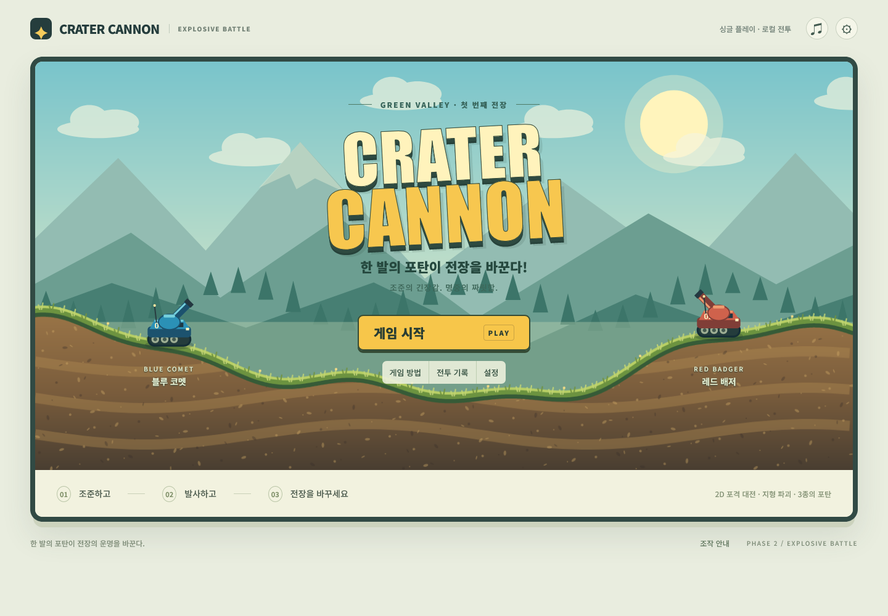

# CRATER CANNON · 크레이터 캐논

> 한 발의 포탄이 전장을 바꾼다!

React + TypeScript + Canvas 2D로 만든 한국어 싱글 플레이 포격 게임입니다. GREEN VALLEY에서 블루 코멧을 조종해 레드 배저 AI와 대결합니다. 계정·백엔드·유료 API·외부 에셋 요청 없이 실행됩니다.



**현재 버전: Phase 2 — EXPLOSIVE BATTLE (1.1.0)** · [상세 완료 및 검증 보고](docs/PHASE2.md)

## 실행

Node.js 24 LTS 권장(22.12+ / 24.x / 26+ 지원). Windows에서는 **Start-Game.cmd를 더블클릭**하면 설치 확인 후 브라우저가 열립니다. 터미널에서는:

```sh
npm ci
npm run dev
```

터미널에 표시되는 로컬 주소를 엽니다. 기본 포트가 사용 중이면 Vite가 다음 포트를 선택합니다.

```sh
npm test
npm run build
npm run preview
```

브라우저 테스트:

```sh
npx playwright install firefox
npm run test:e2e
npm run build && npm run test:smoke
```

E2E는 4187번 포트를 독점 사용합니다. 테스트 모드에만 읽기 전용 QA 상태를 제공하며, 프로덕션 빌드에는 QA 브리지가 포함되지 않습니다.

## 조작

- 전장에서 마우스 드래그 / ↑ ↓: 포신 각도 10–80°
- ← → / 슬라이더: 발사 세기 20–100
- Shift + 방향키: 0.25 단위 미세 조절
- Space / 발사 버튼: 한 발 발사
- 1 / 2 / 3: 포탄 선택
- Esc: 설정 및 일시정지
- 슬라이더나 버튼에 키보드 초점이 있으면 해당 표준 UI 조작을 우선합니다. 전장을 클릭하면 게임 단축키를 사용할 수 있습니다.

## 포탄

| 포탄        | 탄약       | 역할                                           |
| ----------- | ---------- | ---------------------------------------------- |
| 기본 폭발탄 | 무제한     | 높은 직접 피해와 중간 크기 구덩이              |
| 크레이터탄  | 경기당 2발 | 낮은 직접 피해, 넓고 깊은 지형 파괴            |
| 충격파탄    | 경기당 2발 | 낮은 직접 피해, 넓은 폭발 범위와 차량 밀어내기 |

기본/크레이터/충격파의 최대 범위 피해는 34/19/17, 직접 충돌 보너스는 9입니다. 범위 피해는 차량 크기를 고려한 거리에 따라 감소하며 실제 남은 HP만큼만 기록됩니다. 자폭도 가능하고 동시 격파는 무승부입니다.

## 구현

- 1/120초 고정 물리, 매 프레임 누적 시간 처리, 탄도에 작용하는 바람과 중력.
- 지형 열 경계와 차량 경로를 연속 검사하여 고속 포탄의 충돌 누락 방지.
- 1픽셀 간격 높이 필드의 원형 하단을 파내는 지형 파괴. 반복 타격은 기반암(화면 하단 22픽셀)까지 추가 파괴합니다. 동굴/오버행은 만들지 않습니다.
- 차량 궤도 폭에서 가장 높은 지점을 지지면으로 사용하고 중력으로 정착합니다. 충격파는 실제 수평 이동 후 새 지면에 정착합니다.
- AI는 플레이어와 같은 발사·충돌 함수로 각도와 세기를 탐색합니다. 난이도별 조준 오차와 특수탄 선택을 적용하며 순간이동이나 명중 보정은 없습니다.
- 양측이 한 발씩 발사한 뒤 -5~+5 바람 갱신. 비행·폭발·정착 중 발사 입력 잠금.
- Canvas 산맥·구름·잔디·흙 단면·차량·반동·파편·피해 숫자, Web Audio 합성 효과음.
- 설정 창과 백그라운드 탭에서 전투 일시정지. 재대결은 새 엔진·새 지형·새 효과 상태를 생성합니다.
- 음소거/볼륨/화면 흔들림/난이도, 최초 발사 안내, 최근 20경기 기록(LocalStorage). 저장소나 오디오가 실패해도 플레이 가능합니다.

## 구조

- `src/game/engine.ts`: 물리, 지형, 무기, AI, 턴, 결과
- `src/game/camera.ts`: 고각 포탄 카메라와 조준 좌표 역변환
- `src/game/renderer.ts`: Canvas 장면과 효과, 지형 캐시, 제한된 파티클
- `src/game/audio.ts`: 오디오 생성과 수명 관리
- `src/game/storage.ts`: 설정/기록 검증 및 로컬 저장
- `src/main.tsx`, `src/style.css`: 한국어 게임 UI와 반응형 레이아웃
- `src/game/phase2.test.ts`: 카메라/효과 수명/AI 전술/저장소 실패 검증
- `src/game/engine.test.ts`: 물리/지형/전투 회귀 테스트
- `tests/game.spec.ts`: 실제 브라우저 조작과 전체 대전 검증

## 범위와 배포

PC 브라우저 우선, 작은 화면에도 조작 패널을 재배치합니다. 온라인 대전·계정·상점·신규 경기장·육성은 포함하지 않습니다. 경기 시간 2~3분은 수동 조준 시간을 포함한 목표이며, 자동으로 정확히 조준하는 테스트의 경기 시간과 다릅니다.

`dist/`는 정적 호스팅 가능한 결과물입니다. 경로는 상대 경로를 사용하며 커스텀 도메인이나 외부 서비스가 필요하지 않습니다. 현재 앱은 도메인/절대 URL을 사용하지 않으므로 환경 변수도 필요 없습니다. 추후 도메인을 연결하는 기능을 추가할 때는 `APP_DOMAIN`/`APP_ORIGIN` 기반 중앙 설정과 `.env.example`을 함께 추가하고 소스에 도메인을 하드코딩하지 않습니다.

자동화 성공은 실제 재미의 증명이 아닙니다. 쉬움부터 3~5판 직접 플레이하며 명중 피드백, 실패 후 보정의 쉬움, AI 공정성, 경기 시간을 평가하세요.
