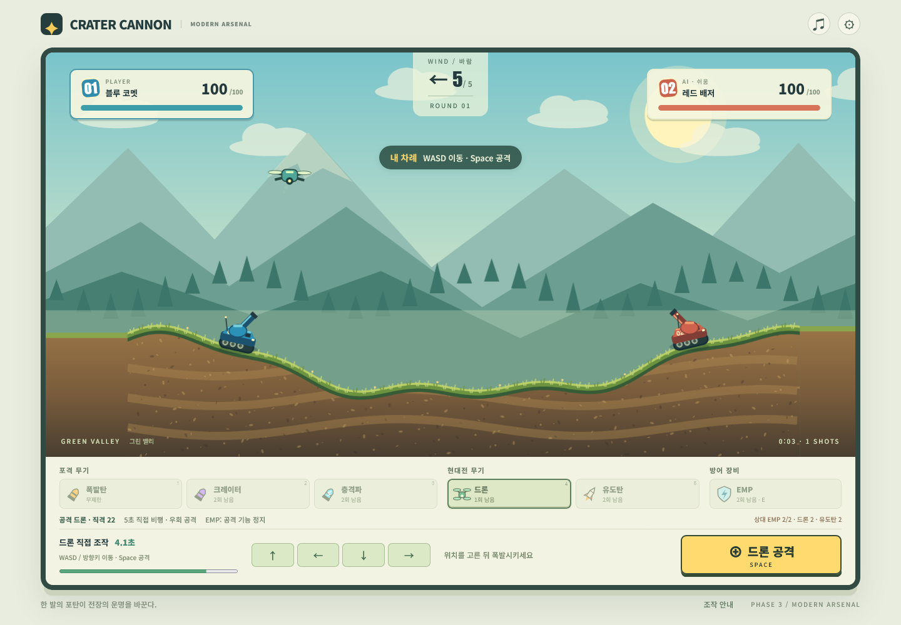
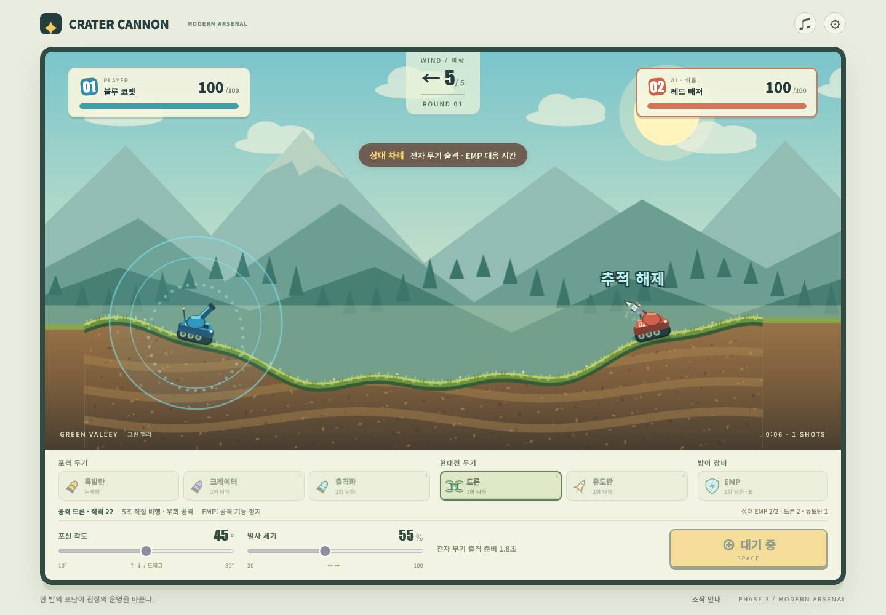
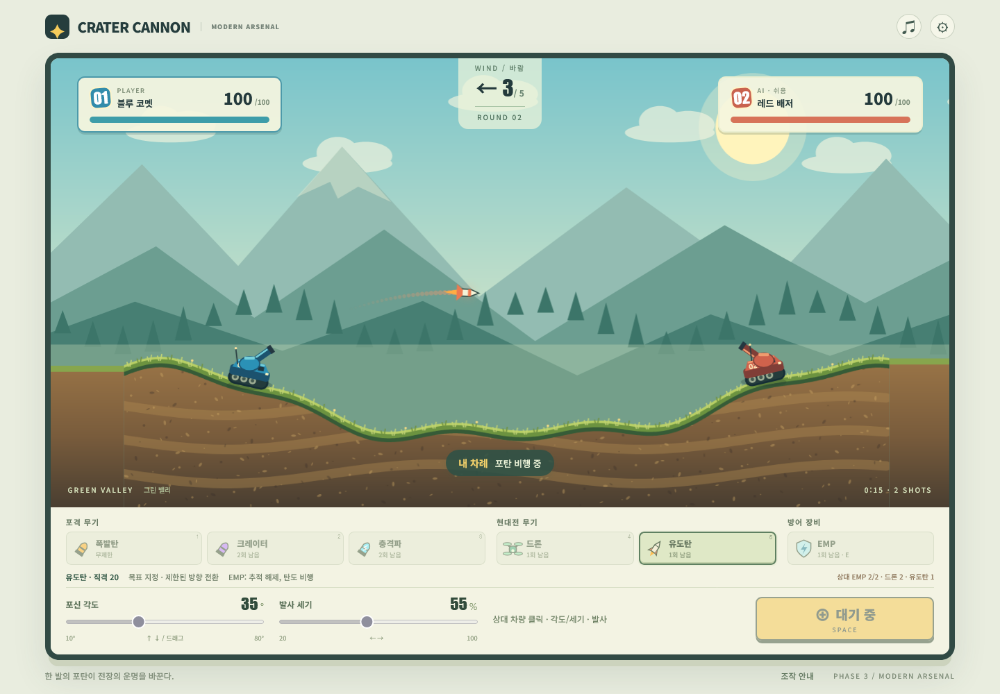

# Phase 3 — MODERN ARSENAL 완료 보고

기준: 2026-11-22 · 버전 1.2.0 · Phase 2 `18f1a57`에서 확장.

## 1. 기존 AI에서 발견한 밸런스 문제

기존 AI는 매 턴 현재 지형·바람에 맞는 정확한 해법을 구하고 작은 독립 오차만 더했다. 보통/어려움에서 첫 발부터 높은 확률로 피해를 입혔으며, 실패한 착탄을 보고 학습하는 과정이 없었다.

같은 초기 지형·바람 40시드(7001–7040)에서 기본탄의 기존/변경 조준 오차를 비교했다. 물리·피해 판정은 현재 엔진으로 통일했으므로 이전 버전 전체 대전 재현이 아니라 **조준 정책만 비교한 수치**다. 명중은 적에게 1 이상의 실제 피해를 준 경우다.

| 난이도 | 이전 첫 발 명중 | 변경 첫 발 명중 | 이전 첫 발 직격 | 변경 첫 발 직격 |
| ------ | --------------- | --------------- | --------------- | --------------- |
| 쉬움   | 52.5%           | 2.5%            | 22.5%           | 0%              |
| 보통   | 95.0%           | 12.5%           | 40.0%           | 7.5%            |
| 어려움 | 100%            | 47.5%           | 52.5%           | 22.5%           |

## 2. 실제 변경한 AI 조준 방식

기존 동일 물리 해법 탐색을 유지하되, 처음에 방향이 무작위인 세기 편향을 만들고 관측한 착탄 위치로 다음 발의 추정을 수정한다. 매 발 독립 오차도 남긴다. 조준값은 화면의 포신과 실제 발사 속도에 그대로 적용한다. 발사 후 일반 포탄 궤적을 수정하거나 피해를 강제로 넣지 않으며, 아직 발생하지 않은 바람 난수를 미리 사용하지 않는다.

| 난이도 | 초기 세기 편향 | 매 발 각도 오차 | 매 발 세기 오차 | 착탄 오차 보정 계수 | AI EMP 선택 확률 |
| ------ | -------------- | --------------- | --------------- | ------------------- | ---------------- |
| 쉬움   | ±19            | ±6°             | ±8              | 0.028               | 12%              |
| 보통   | ±11            | ±3.5°           | ±5              | 0.035               | 46%              |
| 어려움 | ±6             | ±2.25°          | ±3              | 0.042               | 72%              |

편향은 ±24로 제한한다. 드론·유도탄의 결과는 일반 포격 보정 자료로 사용하지 않는다. AI는 남은 탄약·HP·지형과 상대 EMP 잔량으로 무기를 선택한다. 상대 EMP가 소진되면 전자 무기 선택 확률을 높인다. AI의 EMP도 같은 2회 제한과 대응 창을 사용하며, 선택했을 때 0.65–1.7초 후 반응한다.

### 고정 시드 대전 결과

난이도별 동일 20시드(10001–10020), 총 60경기를 실제 엔진으로 끝까지 실행했다. 상대 자동 플레이어는 탄도 해법 + 각도 ±4°/세기 ±5 오차, 혼합 무기, 65% EMP 선택을 사용했다. 유도탄은 35°/55, 드론은 공개 이동 입력으로 조종한다. HP·차량 위치·승패를 주입하지 않았다. 입력 판단 시간은 포함하지 않는다.

| 난이도 | AI 전체 명중률 | AI 직격률 | AI 승률 | 평균 시간 | 평균 AI EMP | 진행 중단 |
| ------ | -------------- | --------- | ------- | --------- | ----------- | --------- |
| 쉬움   | 34.5%          | 15.0%     | 0%      | 50.6초    | 0.25회      | 0         |
| 보통   | 59.5%          | 26.8%     | 25%     | 65.9초    | 1.15회      | 0         |
| 어려움 | 73.6%          | 46.4%     | 50%     | 63.5초    | 1.40회      | 0         |

AI의 무기별 사용 횟수 / 사용 비율 / 사용당 평균 적 피해(빗나감·EMP 무력화 포함):

| 난이도 | 기본탄             | 크레이터탄        | 충격파탄          | 드론               | 유도탄             |
| ------ | ------------------ | ----------------- | ----------------- | ------------------ | ------------------ |
| 쉬움   | 102 / 90.3% / 5.59 | 0 / 0% / —        | 0 / 0% / —        | 5 / 4.4% / 6.60    | 6 / 5.3% / 11.33   |
| 보통   | 70 / 45.8% / 9.77  | 17 / 11.1% / 4.71 | 20 / 13.1% / 2.65 | 21 / 13.7% / 8.62  | 25 / 16.3% / 12.08 |
| 어려움 | 43 / 30.7% / 13.05 | 6 / 4.3% / 3.83   | 15 / 10.7% / 9.40 | 38 / 27.1% / 12.16 | 38 / 27.1% / 12.89 |

새 무기는 명중하기 쉽지만 횟수와 EMP 대응으로 제한했다. 어려움의 기본탄 평균 피해는 전자 무기와 비슷하다. 지형·밀림 중심인 크레이터/충격파의 가치는 피해 수치만으로 비교할 수 없다. 쉬움은 정확한 자동 플레이어에게 20패이므로 초보자 승률로 해석하지 않는다. 표본이 작고 전략이 고정되어 있으며, 자동 플레이는 사람의 체감 난이도를 대체하지 못한다.

재현: `npm run test:balance`. 원자료: [balance-phase3.json](balance-phase3.json). `BALANCE_MATCHES`로 난이도별 경기 수를 조절할 수 있다.

## 3. 공격 드론 구현 내용

차량에서 떠오르는 출격 애니메이션과 2.4초 EMP 창 이후 5초 직접 조작을 제공한다. WASD/방향키 또는 터치 패드로 이동하고 Space/공격 버튼으로 현재 위치에서 폭발시킨다. 차량과 지형의 연속 충돌 판정을 적용하며, 지형 충돌도 공격을 종료한다. 시간 만료는 피해 없이 종료된다.

드론 조작 중 두 차량의 위치를 고정하고 다른 발사/무기 교체를 잠근다. 프로펠러·기체 기울기·비행 잔상·합성 비행음을 제공한다. AI도 같은 속도와 시간 제한으로 비행하고 목표 위치에 난이도별 오차를 준다. EMP에 무력화되면 공격과 지형 파괴 없이 턴을 마무리한다.

## 4. 유도탄 구현 내용

상대 차량 또는 명시적인 목표 지정 버튼을 눌러야 발사할 수 있다. 포신 각도와 세기가 초기 속도를 결정한다. 추적은 최대 3.2초, 회전은 초당 0.85라디안으로 제한하고 현재 차량 위치를 향해 조금씩 회전한다. 순간이동·확정 명중은 없다. 지나친 고각 발사는 추적하지 못하고 빗나갈 수 있다.

기존 지형/차량 연속 충돌 함수를 재사용한다. EMP는 추적만 해제하며 현재 위치·속도를 유지한 채 일반 중력·바람 탄도로 바꾼다. 원래 조준이 맞았다면 교란 후에도 피해를 줄 수 있다. 기체·꼬리날개·추진 화염·잔상과 목표 조준점을 표시한다.

## 5. EMP 방어 구현 내용

양측 경기당 2회, 공격 턴을 소비하지 않는 반응 행동이다. 전자 무기 출격을 알리고 **이동 공격이 시작되기 전 2.4초**를 보장한다. 유도탄은 이 준비 시간에 포구에서 대기하고, 드론은 차량 위로 상승한다. 따라서 가까운 거리에서도 2초 미만의 강제 반응을 요구하지 않는다.

E 또는 EMP 버튼으로 수동 사용한다. 기본값은 수동이며 설정에서 자동 EMP를 켜면 위협 발생 0.9초 후 사용한다. 일반탄·아군 공격·시간이 끝난 공격·이미 방어한 공격에는 사용할 수 없다. 파동/입자/전자음과 드론 정지 또는 추적 해제 표시가 나타난다.

## 6. 신규 무기 조작 방법

- `1/2/3`: 기존 포탄, `4`: 드론, `5`: 유도탄.
- 드론: 출격 → WASD/방향키로 이동 → Space로 공격. 화면 방향 버튼을 누르고 있어도 이동한다.
- 유도탄: 상대 차량 클릭 또는 목표 지정 버튼 → 각도·세기 설정 → Space/발사.
- EMP: 상대 출격 경고 중 `E` 또는 EMP 버튼. 잔량과 대응 시간이 표시된다.
- Esc 또는 설정 버튼으로 일시정지. 탭 숨김·초점 해제 시 이동 입력을 정리한다.
- 포격/현대전/방어를 구분한 아이콘·잔량·특징·직격 피해·대응법을 제공한다. 첫 사용 안내는 건너뛸 수 있고 선택을 로컬 저장한다.

## 7. 무기별 피해량 및 제한

| 무기        | 직격 | 최대 범위 피해 | 폭발 반경 | 지형 반경 / 깊이 계수 | 경기당 횟수 |
| ----------- | ---- | -------------- | --------- | --------------------- | ----------- |
| 기본 폭발탄 | 28   | 20             | 68        | 48 / 0.85             | 무제한      |
| 크레이터탄  | 18   | 12             | 90        | 92 / 1.20             | 2           |
| 충격파탄    | 16   | 10             | 120       | 25 / 0.45             | 2           |
| 공격 드론   | 22   | 16             | 64        | 28 / 0.60             | 2           |
| 유도탄      | 20   | 14             | 60        | 32 / 0.65             | 2           |
| EMP         | 0    | 0              | —         | 없음                  | 2           |

반경은 게임 월드 좌표 단위다. 직격은 범위 피해와 더하지 않는다. 범위 피해는 거리에 따라 감소하고 실제 남은 HP만 기록한다. 충격파는 별도의 밀림을 유지한다. 전자 무기도 발사 시 탄약을 소비하므로 EMP로 막혀도 반환하지 않는다.

## 8. 수정하거나 추가한 파일

| 파일                                               | 변경                                                               |
| -------------------------------------------------- | ------------------------------------------------------------------ |
| `src/game/engine.ts`                               | 새 공격/방어 상태, 제한 추적, 직접 비행, AI 착탄 기억, 무기별 통계 |
| `src/components/Arsenal.tsx`                       | 분류별 무기 패널, 아이콘, 목표 지정, 드론 조작 패드                |
| `src/main.tsx`, `src/style.css`                    | 키보드/터치, 경고와 타이머, 첫 사용 안내, 설정, 반응형 화면        |
| `src/game/renderer.ts`, `audio.ts`, `camera.ts`    | 드론/유도탄/EMP 렌더링·소리·카메라 추적                            |
| `src/game/storage.ts`                              | 자동 EMP 설정, 안내 확인 저장                                      |
| `src/game/qa.ts`                                   | 테스트 전용 읽기 전용 상태 확장                                    |
| `src/game/phase3.test.ts`, `tests/arsenal.spec.ts` | 엔진 경계 조건과 실제 UI 전투 검증                                 |
| `scripts/balance.ts`, `docs/balance-phase3.json`   | 재현 가능한 밸런스 측정과 원자료                                   |
| `package.json`, `package-lock.json`                | 버전 1.2.0, tsx, 밸런스 실행 명령                                  |
| `README.md`, `docs/PHASE3.md`, `docs/screenshots/` | 실행 안내와 완료 보고·화면                                         |

기존 Phase 1/2 엔진·충돌·지형·카메라·효과·턴·결과를 확장했다. 기존 테스트 파일의 검증 조건을 약화하지 않았다.

## 9. 빌드와 테스트 결과

- `npm test`: 기존 32개 + 신규 24개, 총 56개 통과.
- `npm run build`: TypeScript 및 Vite 프로덕션 빌드 성공.
- `npm run test:e2e`: 기존 6개 + 신규 2개, 총 8개 시나리오 통과.
- `npm run test:smoke`: 프로덕션 메뉴/발사/AI 턴, 브라우저 오류 없음, 외부 요청 없음, QA 브리지 없음.
- 고정 시드 60경기 전부 정상 종료. 난이도별 40개 첫 발 비교 완료.
- `npm audit`: 알려진 취약점 0개.

새 엔진 테스트는 드론 출격/입력/시간/지형/중복 공격, 유도탄 목표/추적 제한/충돌/교란 후 물리, EMP 횟수/대응 시간/무효 대상/자동 방어, AI 보정/탄약/공정한 발사/정상 턴 종료를 검사한다.

## 10. 실제 브라우저 플레이 검증 여부

Playwright Firefox에서 실제 UI와 키보드/포인터로 일반탄 대전 3난이도, 드론 이동·공격, 유도탄 지정·발사, 적 드론/유도탄 EMP 방어, 경기 종료와 재대결을 검증했다. 테스트 시계로 시간을 진행했으며 읽기 전용 QA로 상태를 관측했다. 공격이나 승패를 QA로 주입하지 않았다.

1366×768 데스크톱에서 발사 패널이 첫 화면 안에 들어오고, 390×844 모바일에서 가로 넘침이 없는 것을 확인했다. 드론·유도탄·EMP 스크린샷을 직접 확인했다. 재대결에서 탄약/EMP/HP/목표/입력/효과가 초기화되는 것을 검사했다.

## 11. 미구현 기능과 알려진 문제

요청한 Phase 3 핵심 기능을 구현했다. 현재 테스트에서 진행 불가·중복 공격·탄약 복제 오류는 발견하지 못했다. 다만 다음은 설계 범위 또는 검증 한계다.

- 전자 무기의 2.4초 준비 구간은 반응 시간을 보장하기 위한 게임 규칙이다. 준비 이후에는 EMP를 사용할 수 없다.
- 5초 드론 시간은 능동 비행 시간이며 출격 준비 시간은 별도다. 비행 시간 만료는 자동 공격이 아니다.
- 매우 높은 유도탄 각도는 추적 실패를 유발한다. 유도 중에는 자체 추진 방향, 교란 후에는 일반 탄도 물리를 쓴다.
- AI는 사람처럼 보정하는 오차 모델이지만 학습형 AI는 아니다. 소규모 고정 전략 자동 대전만으로 재미와 모든 전략의 균형을 증명할 수 없다.
- 모바일 배치는 검증했지만 실제 휴대폰 터치 지연과 모든 브라우저/오디오 장치의 체감은 확인하지 않았다.
- 신규 차량·경기장·멀티플레이·실제 군사 성능·계정·상점·육성은 이번 범위에 포함하지 않았다.

## 12. 플레이어가 직접 확인해야 할 사항

1. 쉬움부터 각 난이도 3–5판: 첫 발이 너무 정확한지, 빗나간 뒤 보정이 납득되는지 확인한다.
2. 드론의 5초 비행과 이동 감도, 수동 폭발 시점, EMP에 막혔을 때 피드백을 확인한다.
3. 유도탄의 낮은 각도/높은 각도 차이와 교란 후에도 날아가는 탄도를 확인한다.
4. 수동 EMP 2.4초가 읽고 판단하기에 충분한지, 자동 방어가 도움이 되는지 확인한다.
5. 전자 무기 탄약을 먼저 쓰는 전략과 EMP 소진을 기다리는 전략을 비교한다.
6. 실제 조준 시간을 포함한 경기 길이, 폭발·소리·직격 쾌감, 작은 화면에서 조작 편의성을 평가한다.
