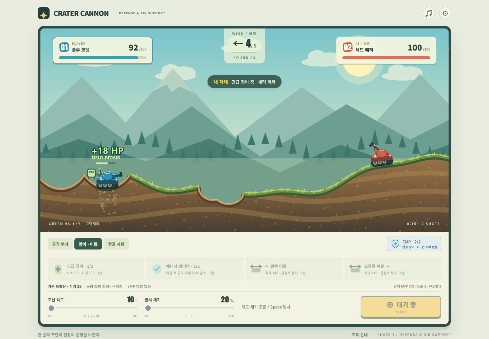
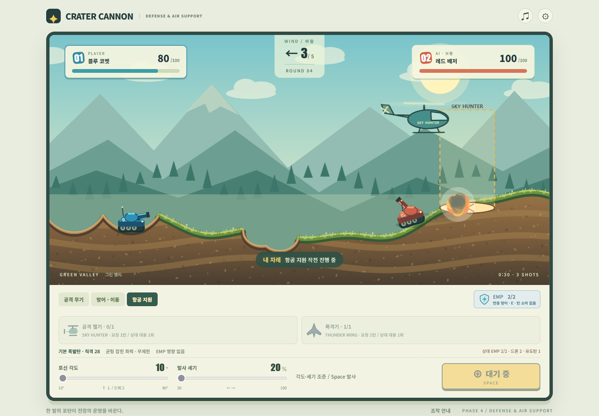
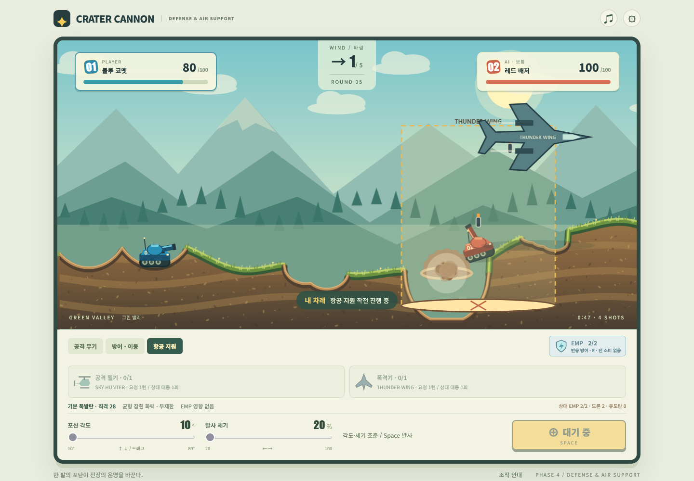
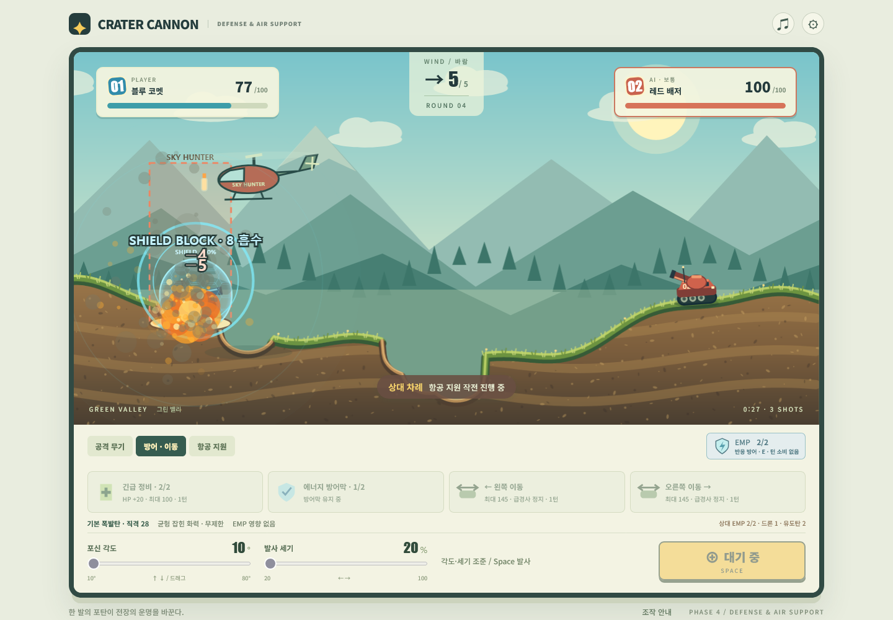

# Phase 4 — DEFENSE & AIR SUPPORT 완료 보고

2026-11-22 · 버전 1.3.0 · Phase 3 `f2968d6`에서 확장.

## 1. 실제 구현된 신규 기능

긴급 정비, 에너지 방어막, 제한 차량 이동, 공격 헬기 SKY HUNTER, 폭격기 THUNDER WING을 실제 플레이 가능한 행동으로 추가했다. 기존 포격 3종·직접 조작 드론·유도탄·파괴 지형·바람·난이도·전투 기록을 유지했다.

행동 UI를 **공격 무기 / 방어 · 이동 / 항공 지원**으로 구분했다. EMP는 카테고리와 관계없이 항상 표시한다. 각 행동에 다른 SVG 아이콘, 남은 횟수, 효과와 턴 비용을 표시한다. 외부 이미지·유료 API 없이 Canvas로 정비 로봇·용접 입자·육각 보호막·로터 회전·대형 폭격기·투하물·지역 경고를 그린다.

차량은 자기 턴에 한 방향으로 최대 145 월드 단위, 초당 95 속도로 연속 이동한다. 이동은 공격 기회를 소비하며 급경사·맵 끝·상대 차량 앞에서 멈춘다. 기존 지면 지지·중력·포탄 충돌을 사용하고 목적지로 순간이동하지 않는다. 이동으로 지원 예정 구역을 벗어나면 실제 피해가 줄어든다.

## 2. 기존 EMP 기능의 개선 내용

기존 `EMP_WINDOW`, `canEmp`, `useEmp`, 자동 방어 설정을 확장했다. 별도 EMP 시스템을 만들지 않았다.

- 대응 시간을 2.4초에서 **4초**로 늘렸다. 양측 같은 창을 사용한다.
- 상단 행동 분류 옆에 EMP 버튼과 `2/2`, `E`, `턴 소비 없음`을 상시 표시한다. 모바일은 독립된 가로줄로 배치한다.
- 적 드론·유도탄 출격 시 큰 경고, 남은 시간, `EMP 사용 [E]` 버튼을 표시하고 준비 중 공격 이동을 보류한다.
- 파동·스파크·전자음과 `전자전 성공` 메시지를 표시한다.
- 자동 EMP는 기본 꺼짐이며 설정에서 바로 바꿀 수 있다. 켜면 감지 0.9초 후 사용하고 정상 차감한다.
- 드론 무력화, 유도탄 추적 해제 후 동일 속도·일반 탄도 비행, 일반 포탄 무효, 공격당 1회, 경기당 2회 규칙을 유지했다.
- 헬기·폭격기에는 EMP를 사용할 수 없다. 이동과 방어막이 대응 수단이다.

## 3. 긴급 정비와 방어막의 작동 방식

| 행동          | 효과                              | 제한                        | 턴 처리                        |
| ------------- | --------------------------------- | --------------------------- | ------------------------------ |
| 긴급 정비     | HP 20, 최대 100                   | 경기당 2회, HP 100에서 불가 | 1.6초 회복 연출 후 다음 턴     |
| 에너지 방어막 | 다음 적 공격 전체의 피해 50% 감소 | 경기당 2회, 중복 설치 불가  | 설치 1턴, 적 공격 종료 시 소멸 |

수리는 정비 로봇·불꽃과 함께 HP를 점진적으로 올린다. 실제 회복량만 표시하므로 HP 82에서는 `+18 HP`다. 진행 중 재입력이나 발사가 불가능하다. AI도 같은 20 회복과 횟수를 사용하며 연속 두 행동을 수리로 선택하지 않는다.

방어막은 모든 기존 공격과 항공 지원에 적용된다. 여러 공격 조각은 누적 피해 기준으로 50%를 계산한다. 예를 들어 헬기의 9+9+9는 방어 후 5+4+5=14, 흡수 13이다. `SHIELD BLOCK` 표시도 실제 흡수량을 누적한다. 실제 HP 피해는 남은 HP로 제한하고 통계에 반영한다.

다음 적 공격이 빗나가거나 EMP로 무력화되어도 종료 시 보호막이 소멸한다. 상대 수리·이동·지원 예약 자체는 공격 피해 처리로 세지 않으므로 보호막을 소모하지 않는다. 방어막이 지형 파괴나 충격파 밀림까지 막지는 않는다.

## 4. 공격 헬기와 폭격기의 차이

| 항목      | SKY HUNTER                                      | THUNDER WING                                            |
| --------- | ----------------------------------------------- | ------------------------------------------------------- |
| 사용      | 경기당 1회                                      | 경기당 1회                                              |
| 대상      | 지정된 좁은 구역                                | 지정된 넓은 구역                                        |
| 피해      | 3회 × 최대 9, 합계 27                           | 구역 중심 최대 30, 거리 감쇠                            |
| 유효 범위 | 각 소공격 중심에서 70                           | 구역 중심에서 170                                       |
| 지형      | 작은 구덩이 3개                                 | 큰 크레이터 3개                                         |
| 연출      | 화면 밖 진입 → 목표 근처 체공 → 3회 공격 → 이탈 | 대형 날개 기체가 상공 통과 → 세 지점 투하/먼지 → 이탈   |
| 약점      | 이동하면 좁은 범위를 완전히 벗어날 수 있음      | 이동으로 중심에서 벗어나 피해 감소, 방어막으로 50% 감소 |

헬기는 지정 당시 구역을 공격하며 이동한 적을 다시 추적하지 않는다. 폭격기는 여러 폭발을 보여도 피해는 구역 중심 기준으로 한 번만 계산하여 30을 90으로 늘리지 않는다. 세 지점의 지형 파괴는 각각 적용한다. 자기 차량이 지정 구역에 있으면 자폭도 가능하다.

기체 경로·페이로드 낙하·로터/날개·기체 색과 소리가 다르다. 기체가 체력 HUD에 가리지 않도록 상공 경로를 조정했고 적 기체의 표기가 좌우 반전되지 않게 했다.

## 5. 항공 지원 대응 턴의 작동 방식

1. 자기 턴에 지원 종류와 구역을 지정한다. 전장 클릭, 슬라이더, `적 위치에 구역 지정` 버튼을 사용할 수 있다.
2. 요청 시 해당 지원의 횟수와 공격 턴을 소비한다. 지면 마커·예정 범위·지원 예약 메시지가 나타난다.
3. 상대에게 평소와 같은 행동 1회를 준다. 공격·수리·방어막·이동을 선택한다.
4. 해당 행동의 비행·폭발·정착까지 끝난 뒤 예약 지원을 시작한다.
5. 지원의 모든 타격과 이탈을 마친 뒤 방어막을 해제하고 요청자의 다음 정상 턴으로 이어진다.

양측 같은 코드 경로를 쓴다. 예약 중 다른 지원 요청은 거절하며 횟수를 차감하지 않는다. 실행 시작 시 예약을 활성 작전으로 옮기고 각 타격에 완료 플래그를 남겨 중복 실행을 막는다. 대응 공격으로 요청자가 격파되면 게임 종료와 함께 예약을 취소한다.

이동만 반복해 경기가 끝나지 않는 상황을 막기 위해 40라운드에서 HP로 판정한다. 마지막에 예약된 지원이 있다면 상대 대응과 지원 실행을 끝까지 정산한 후 판정하며 동률은 무승부다.

## 6. AI 밸런스 변경 사항

Phase 3의 초기 세기 편향, 난이도별 각도·세기 오차, 관측 착탄 보정과 동일 탄도 발사를 유지했다. 첫 행동은 기존 포격을 유지해 학습 진입을 쉽게 했다. 이후 공개된 예정 구역, 지형, HP, 남은 자원으로 다음 행동을 고려한다.

- 낮은 HP에서 수리: 쉬움 35 이하, 보통/어려움 55 이하. 연속 수리 선택 금지.
- 위협 구역에서 이동 또는 방어막을 고려한다. 판단 확률은 쉬움 30%·보통 65%·어려움 85%로 항상 최적 행동은 아니다.
- 지원 요청 확률은 조건 충족 시 쉬움 12%·보통 28%·어려움 40%. 목표 위치에는 난이도별 오차가 있다.
- EMP 횟수·타이밍, 수리량, 보호막 계수, 항공 피해, 이동 제한은 플레이어와 같다.
- 미래 바람이나 상대의 아직 선택하지 않은 대응을 미리 읽지 않는다. 숨겨진 피해 보정은 없다.

### 고정 시드 60경기

난이도별 동일 20시드(10001–10020). 상대 자동 플레이어는 기존 탄도 해법 + 각도 ±4°/세기 ±5 오차, 혼합 무기, 65% EMP 선택을 사용한다. 추가로 HP 45 이하 수리, 항공 지원 요청, 공개된 공격 구역에 이동/방어막으로 대응한다. HP·위치·피해·승패를 주입하지 않는다.

| 난이도 | AI 명중률 | AI 승률 | 평균 시간 | 평균 라운드 | 진행 중단 |
| ------ | --------- | ------- | --------- | ----------- | --------- |
| 쉬움   | 32.8%     | 0%      | 63.9초    | 7.85        | 0         |
| 보통   | 52.4%     | 15%     | 113.0초   | 13.2        | 0         |
| 어려움 | 62.2%     | 40%     | 138.8초   | 16.2        | 0         |

AI의 20경기 합계 행동 사용량:

| 난이도 | 수리 | 방어막 | 이동 | 헬기 요청 | 폭격기 요청 |
| ------ | ---- | ------ | ---- | --------- | ----------- |
| 쉬움   | 11   | 8      | 3    | 3         | 2           |
| 보통   | 38   | 16     | 11   | 8         | 10          |
| 어려움 | 39   | 12     | 15   | 20        | 18          |

AI 무기별 사용당 실제 평균 적 피해(빗나감과 방어로 줄어든 피해 포함):

| 난이도 | 기본탄 | 크레이터 | 충격파 | 드론 | 유도탄 | 헬기  | 폭격기 |
| ------ | ------ | -------- | ------ | ---- | ------ | ----- | ------ |
| 쉬움   | 4.87   | 미사용   | 미사용 | 0    | 11.43  | 10.67 | 19.00  |
| 보통   | 8.42   | 3.60     | 3.32   | 9.30 | 11.26  | 5.25  | 10.50  |
| 어려움 | 8.64   | 6.00     | 6.50   | 9.59 | 11.24  | 8.90  | 13.44  |

60경기 모두 40라운드 판정 전에 종료했다. 가장 긴 경기는 쉬움 15라운드/120.8초, 보통 21라운드/202.0초, 어려움 23라운드/212.6초였다.

지원의 위력은 대응으로 줄고 사용도 경기당 한 번뿐이다. 방어·수리 때문에 기존보다 경기 시간은 늘었지만 자동 대전에서 정체되지는 않았다. 쉬움의 승률 0%는 정확한 자동 플레이어 상대 수치이며 초보자의 승률을 뜻하지 않는다.

시간에는 사람의 판단·조준 시간이 없다. 보통에서 자기 턴당 6–10초를 더한다는 단순 가정이면 약 3.2–4.1분, 어려움은 3.9–5.0분이다. 이는 실제 플레이 관측이 아닌 추정이며, 쉬움은 더 짧다. **3–5분 체감 목표와 재미는 사람의 플레이로 확인해야 한다.**

재현: `npm run test:balance`. 원자료와 무기 사용 비율·최대 경기 길이: [balance-phase4.json](balance-phase4.json). 과거 보고서의 수치는 보존했다.

## 7. 주요 코드 변경 내용

| 파일                                                          | 역할                                                              |
| ------------------------------------------------------------- | ----------------------------------------------------------------- |
| `src/game/engine.ts`                                          | 수리/방어/이동 행동, 예약/대응/작전 상태, 통합 피해, 턴·승패 정산 |
| `src/game/defense.ts`                                         | 회복 상한과 누적 방어 피해 계산                                   |
| `src/game/movement.ts`                                        | 이동 거리·속도·급경사·장애물 제한                                 |
| `src/game/airSupport.ts`                                      | 지원별 일정·피해·기체 경로                                        |
| `src/game/tactics.ts`                                         | AI 방어·지원 선택                                                 |
| `src/game/tacticalRenderer.ts`                                | 정비 로봇·육각 방어막·경고 구역·항공기·투하물                     |
| `src/game/renderer.ts`, `audio.ts`                            | 흡수 수치와 EMP 성공 표시, 신규 효과와 소리                       |
| `src/components/Arsenal.tsx`, `src/main.tsx`, `src/style.css` | 행동 카테고리·상시 EMP·지역 지정·대응 안내·반응형 화면            |
| `src/game/qa.ts`                                              | 테스트 전용 읽기 전용 상태 확장                                   |
| `src/game/phase4.test.ts`, `tests/defense-air.spec.ts`        | 엔진 경계 조건과 실제 UI 대전 검증                                |
| `scripts/balance-phase4.ts`, `docs/balance-phase4.json`       | 전술 포함 대전 측정과 원자료                                      |
| `package.json`, `package-lock.json`, `README.md`, `docs/`     | 버전 1.3.0, 실행 명령과 완료 보고                                 |

저장소 키·설정/기록 형식을 유지했다. 기존 Phase 3 테스트 중 EMP 만료 경계 두 곳만 새 4초 상수에 맞췄으며 기존 검증을 삭제하지 않았다. 게임 상태와 연출을 분리하여 렌더링 없이도 동일 결과를 얻는다.

## 8. 빌드 및 테스트 결과

- `npm test`: 기존 56개 + 신규 28개, **84개 통과**.
- `npm run build`: TypeScript와 Vite 프로덕션 빌드 성공.
- `npm run test:e2e`: 기존 8개 + 신규 3개, **11개 시나리오 통과**.
- `npm run test:smoke`: 프로덕션 메뉴·발사·AI 반격, 페이지 오류 없음, 외부 요청 없음, QA 브리지 없음.
- 고정 시드 60경기 정상 종료.
- `npm audit`: 알려진 취약점 0개.

새 테스트는 회복·최대 HP·횟수·턴 소비·중복 입력, 모든 공격의 방어 피해·소멸, 4초 EMP 창, 이동 거리·경사·충돌, 지원 횟수·대응 행동·중첩 거부·정확히 한 번 실행·지형 파괴·취소, AI 수리/회피/지원 선택, 최종 라운드 예약 정산, 렌더 업데이트 분할과 무관한 결과를 포함한다.

## 9. 실제 브라우저 플레이 검증 여부

Playwright Firefox에서 DOM 버튼과 실제 키보드·포인터 입력으로 다음을 검증했다. 테스트 시계로 시간을 진행하고 읽기 전용 QA로 상태를 확인했다. 게임 HP·차량 위치·승패를 QA로 주입하지 않았다.

| 요청한 시나리오               | 확인 결과                                                                        |
| ----------------------------- | -------------------------------------------------------------------------------- |
| 수리 후 승리                  | 실제 포격을 두 번 주고받아 피해를 받은 뒤 수리, 항공 지원과 포격으로 승리·재대결 |
| 방어막으로 강력한 공격 방어   | 적 헬기 예고에 방어막 설치, 세 공격 전체 피해 감소와 소멸 확인                   |
| EMP로 드론 공격 차단          | 기존 브라우저 테스트 유지, E/버튼·탄약·자동 설정 저장 검증                       |
| 헬기 공격 후 AI 반격          | 아군 헬기 예약·상대 대응·기체 공격·다음 턴을 거쳐 전체 경기 완료                 |
| 폭격 예정 구역 회피           | 적 폭격 예고 후 실제 왼쪽 이동, 피해 10 미만 확인                                |
| 폭격기 공격 후 지형 파괴      | 세 지점 지형 revision 증가, 실제 크레이터 화면 확인                              |
| 항공 지원 없이 기존 포격 승리 | 기존 3난이도 포격 전체 경기 테스트 통과                                          |

1366×768에서 발사 패널이 첫 화면에 있고, 390×844에서 가로 넘침이 없는 것을 확인했다. 수리·방어막·헬기·폭격기·목표 구역·승리 화면을 직접 검수했다. 설정 일시정지·재대결 자원 초기화·입력 잠금도 검사했다.

## 10. 남은 오류와 미구현 기능

요청한 Phase 4 핵심 기능은 모두 구현했다. 현재 자동 검증과 화면 검수에서 진행 불가·중복 피해·예약 중복 실행 오류는 발견하지 못했다. 다음은 현재 설계 범위와 검증 한계다.

- 지원은 한 번에 하나만 예약한다. 헬기도 폭격기와 같은 공개 대응 행동을 제공한다.
- 이동은 자유 주행이 아닌 1턴짜리 짧은 행동이다. 깊은 구덩이의 급경사에서는 탈출이 제한될 수 있다.
- 항공 피해는 게임용 영역 규칙이며 실제 항공 무기·군사 절차를 재현하지 않는다. 지형은 기존 높이 필드여서 동굴·오버행을 만들지 않는다.
- 자동 대전은 고정 전략과 난이도별 20경기 표본이다. 실제 사람의 난이도·소리의 타격감·3–5분 목표·실제 휴대폰 터치 지연은 직접 플레이로 확인해야 한다.
- 신규 차량·경기장·계정·멀티플레이·상점·캠페인은 이번 범위에 포함하지 않았다.

직접 플레이에서는 수리와 공격의 기회비용, 방어막과 회피의 선택, EMP 4초의 여유, 항공 지원의 시각적 박진감을 우선 확인하면 된다.
