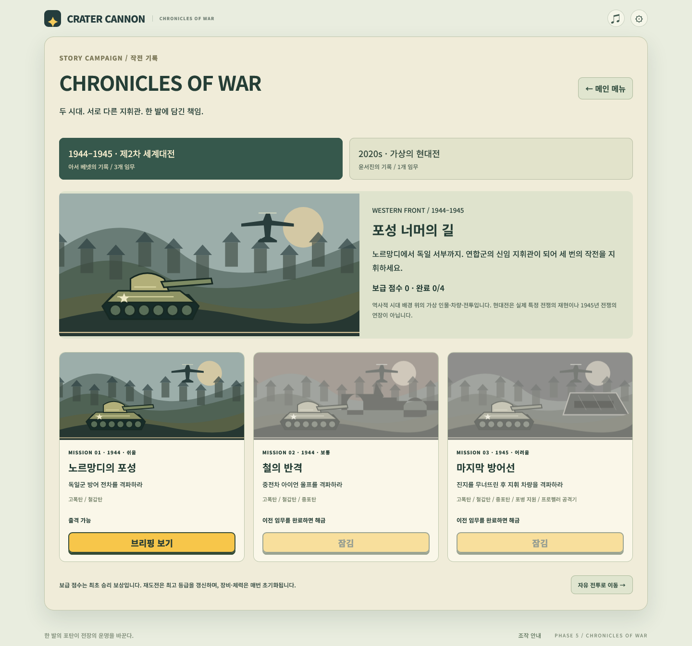
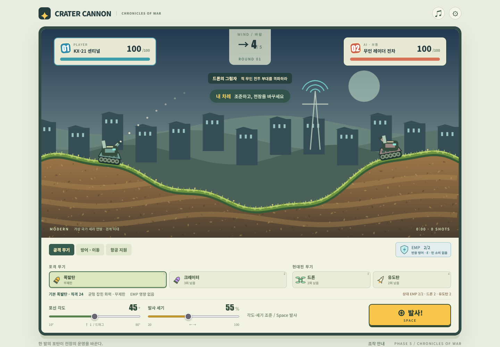
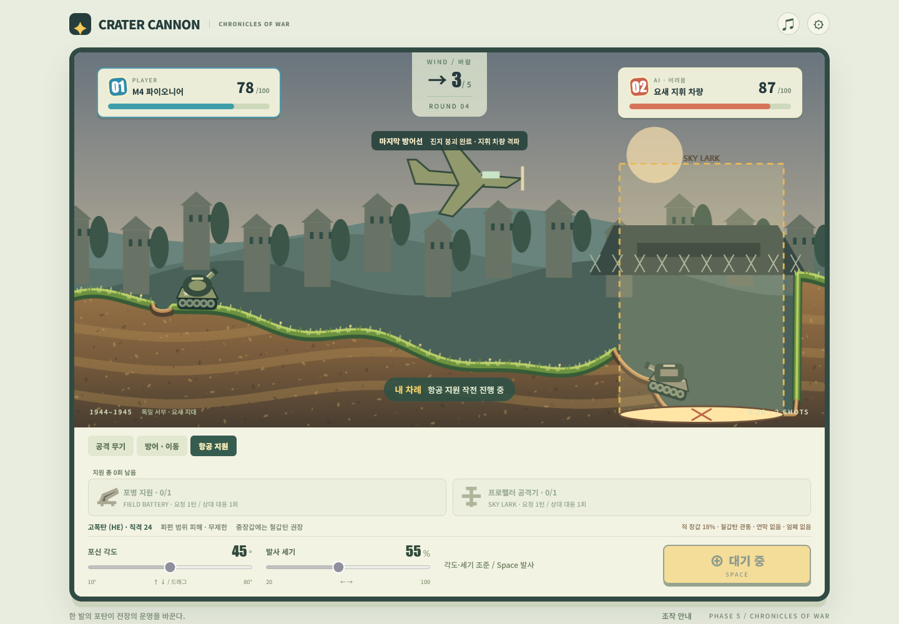
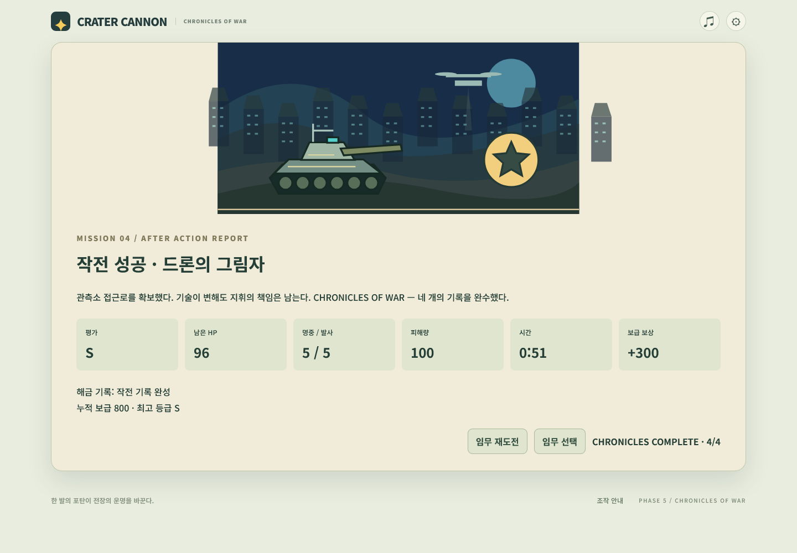

# Phase 5 — CHRONICLES OF WAR 완료 보고

2026-11-22 · 1.4.0 · Phase 4 `04dad2a`에서 확장.

## 1. 구현한 스토리 캠페인

메인 메뉴에 스토리 캠페인과 자유 전투를 분리했다. WWII 3개 임무와 가상의 현대전 1개 임무를 구현했다. 캠페인 선택 → 임무 카드 → 지휘관 무전 브리핑 → 전투 → 결과·보상 → 다음 임무로 이어진다. 잠긴 임무에는 선행 완료 조건, 완료 임무에는 최고 등급과 다시 플레이 버튼을 표시한다.

첫 승리 보급 점수는 100/150/250/300이다. 보급은 기록용이며 구매나 강화에 사용하지 않는다. 등급은 HP 65 이상·12발 이하 S, HP 30 이상 A, 그 외 B다. 재도전은 최고 등급만 갱신하고 보급은 중복 지급하지 않는다. 현대 임무 완료 후 4/4 작전 기록 완수를 표시한다.

## 2. 시대별 무기 제한

`eras.ts`의 시대 허용 목록과 각 임무 설정을 교차 적용한다. UI, 숫자키, 탄약 초기화, 발사, EMP, 방어막, 지원 요청, AI 선택에서 같은 규칙을 사용한다. 금지 장비 탄약을 임의로 늘리는 테스트에서도 발사·요청은 거부된다.

- WWII: 고폭탄 HE, 철갑탄 AP, 중포탄. 임무별 야전 수리·연막·엄폐·이동·포병·프로펠러 지원.
- 현대: 기존 폭발탄·크레이터탄·충격파탄·드론·유도탄·EMP·정비·방어막·이동·헬기·폭격기를 자유 전투에서 유지한다.
- 현대 도입 임무는 폭발탄·크레이터탄·드론·유도탄·EMP·정비·방어막·이동에 집중하며 항공 지원은 제공하지 않는다.

WWII에는 현대 전자 무기·EMP·에너지 방어막·헬기·현대 폭격기를 제공하지 않는다. 지원 버튼도 해당 시대 종류만 그린다.

## 3. 제2차 세계대전 전투

| 임무            | 구현                                                                                     |
| --------------- | ---------------------------------------------------------------------------------------- |
| 노르망디의 포성 | 쉬움, 방어 전차 격파, 고폭탄·철갑탄 6발, 수리 1회, 첫 포격 가이드                        |
| 철의 반격       | 보통, 타이거 계열에서 영감을 받은 가상 중전차, 일반 피해 28% 장갑, 철갑탄 8발, 연막·엄폐 |
| 마지막 방어선   | 어려움, 강화 진지와 지휘 차량, 적 포병, 아군 포병·프로펠러 각 1회                        |

진지는 일반 피해 55% 감소와 HP 하한 40을 제공한다. 고정 기초 구역의 평균 지형 파괴 깊이 18 또는 철갑탄 3회 직격으로 구조가 붕괴한다. 이후 HP 하한이 없어지고 장갑 18%만 남는다. 진행률과 철갑 직격 수를 HUD에 보여준다. 지형 파괴와 관통 두 경로가 있어 특정 탄종 고갈로 임무가 막히지 않는다. 진지가 유지되는 동안 적 지휘 차량은 이동할 수 없다.

연막은 다음 적 포격의 실제 발사 각도 ±4도·세기 ±5 오차를 만든다. 발사 후 궤적을 숨겨서 보정하지 않는다. 엄폐는 다음 적 공격 피해 35% 감소, 철갑탄에는 15% 감소다. 두 행동은 각각 2회·1턴이며 다음 공격 종료에 해제된다. AI도 같은 자원·공격 경로를 쓴다.

## 4. 현대전 전환

임무 3 승리 후 16초 전환: 1945 → 전후 기술 → 새로운 전자전 시대 → 가상 2020s. 시간에 따라 전차·프로펠러 삽화가 현대 차량·드론으로 바뀌고 설명 문장이 순서대로 나온다. 건너뛰기와 자동 종료 모두 지원하며 시청 여부를 저장한다.

WWII 주인공 아서 베넷과 현대 주인공 윤서진은 서로 다른 인물이다. 현대전은 가상 국가 세라 연방의 분쟁이며 실제 특정 현대 전쟁이나 WWII의 연장이 아님을 선택·전환·브리핑에 명시했다. 현대 도입 임무의 적 첫 공격은 브리핑에서 예고한 드론이다.

## 5. 차량과 전장·그래픽

노르망디 들판, 프랑스 철도 교차로, 독일 서부 요새, 가상 현대 국경의 네 배경과 지형 변형을 추가했다. 기존 GREEN VALLEY는 자유 전투에 남아 있다.

M4 파이오니어, 방어 전차, 아이언 울프 중전차, 요새 지휘 차량, KX-21 센티널, 무인 레이더 전차를 시대별 차체·포탑·색·센서로 구분한다. 실제 차량의 정밀 복원은 아니다. 지휘관 초상 2개, 캠페인 대표·임무·완료 삽화, 회전 프로펠러와 투하 연출을 직접 작성한 SVG/Canvas로 구현했다. 외부 이미지나 유료 생성 API는 사용하지 않았다. 포병·프로펠러·현대 항공 지원에 구분되는 합성 음향을 적용했다.

## 6. 공격·방어 밸런스

| 항목                   | Phase 4 → Phase 5                                     |
| ---------------------- | ----------------------------------------------------- |
| 폭발탄 직격 / 범위     | 28/20 → 24/17                                         |
| 크레이터탄 직격 / 범위 | 18/12 → 16/10                                         |
| 드론 직격 / 범위       | 22/16 → 18/13                                         |
| 유도탄 직격 / 범위     | 20/14 → 18/12                                         |
| 수리                   | 20 → 28, 두 번, 연속 자기 행동 수리 불가              |
| 현대 방어막            | 사전 설치 1턴 유지 + 적 공격 중 R 반응은 턴 소비 없음 |
| 일반 포격·항공 대응    | 현대 공격 시작 2.5초 대응 시간                        |
| 헬기·폭격기            | 각 1회 → 둘 중 합계 1회                               |

방어막은 다음 적 공격 전체 피해 50%를 줄이며 누적 반올림·빗나감 소멸·EMP 무력화 후 소멸 규칙을 유지한다. 전자 무기의 EMP 대응 창은 기존 4초다. AI는 자신의 HP와 공개된 턴 상태에 따라 반응 방어막을 사용하며 플레이어의 미래 착탄이나 결과를 읽지 않는다.

70경기 측정: 각 임무와 자유 전투 난이도별 같은 시드 31–40, 각 10경기. 탄도 해법에 ±2도·±3세기 오차, 적절한 철갑탄, HP 45 이하 수리, 반응 방어·EMP와 지원을 사용하는 자동 플레이어다. HP·위치·승패를 주입하지 않았다.

| 시나리오      | 자동 플레이어 승리 | AI 명중률 | 평균 라운드 | 평균 시뮬레이션 시간 |
| ------------- | ------------------ | --------- | ----------- | -------------------- |
| 노르망디      | 10/10              | 34.8%     | 8.2         | 53초                 |
| 철의 반격     | 10/10              | 41.9%     | 10.1        | 64초                 |
| 마지막 방어선 | 9/10               | 50.7%     | 11.4        | 84초                 |
| 드론의 그림자 | 10/10              | 46.2%     | 10.8        | 117초                |
| 자유 쉬움     | 10/10              | 24.2%     | 8.8         | 101초                |
| 자유 보통     | 10/10              | 43.5%     | 9.6         | 105초                |
| 자유 어려움   | 10/10              | 64.2%     | 10.3        | 116초                |

시간 초과·40라운드 판정은 0회였다. 자동 플레이어가 탄도 해법과 방어를 능숙하게 사용하는 측정이므로 인간 승률·난이도·재미의 증거가 아니다. Phase 4 측정과는 오차·대응 정책이 달라 직접적인 승률 비교로 사용하지 않는다. 실제 사람 플레이로 추가 조정할 여지가 있다. [전체 측정](balance-phase5.json)

## 7. 저장과 이어하기

독립된 버전 1 키 `crater.campaign.v1`에 현재 임무, 완료·해금 목록, 최고 등급, 보급, 장비 해금, 전환 시청 여부를 저장한다. 새로고침 후 임무 선택에서 이어 출격할 수 있다. 출격 중 상태는 저장하지 않으며 새 출격은 체력·탄약·방어·지원·효과를 초기화한다.

손상 JSON, 지원하지 않는 버전, 잘못된 ID·등급·해금·보급 값을 복구한다. 완료 순서로 해금과 보상을 재계산하여 불일치 데이터를 제한한다. 저장 불가 시 현재 창의 진행은 유지하고 사용자에게 알린다. 기존 설정·자유 전투 기록 키는 유지한다. 캠페인 결과는 자유 전투 기록에 넣지 않으므로 기존 20개 기록을 밀어내지 않는다.

## 8. 주요 파일

- 데이터·저장: `src/game/eras.ts`, `campaign.ts`, `campaignStorage.ts`.
- UI·아트: `src/components/Campaign.tsx`, `Arsenal.tsx`, `src/game/campaignRenderer.ts`, `src/main.tsx`, `src/style.css`.
- 전투: `src/game/engine.ts`, `defense.ts`, `airSupport.ts`, `tactics.ts`, `tacticalRenderer.ts`, `audio.ts`, `renderer.ts`.
- 검증: `src/game/phase5.test.ts`, `tests/campaign.spec.ts`, `scripts/balance-phase5.ts`, 기존 회귀 테스트.
- 실행·문서: `vite.config.ts`, `package.json`, `package-lock.json`, `README.md`.

## 9. 빌드와 테스트

- `npm test`: 5개 파일, **113개 통과**. 기존 84개와 신규 29개.
- `npm run build`: TypeScript 및 Vite 프로덕션 빌드 성공. JS gzip 약 109 KB.
- `npm run test:smoke`: 프로덕션 메뉴·발사·AI 응답 성공, 외부 요청·페이지 오류 없음, QA 브리지 제외 확인.
- `npm run test:balance`: **70경기 종료**, 시간 초과 0.
- `npm run test:e2e`: **16개 시나리오 검증 완료**. 전체 실행 15개 통과 후, 새 대응 시간에 맞춰 갱신한 고각 카메라 테스트를 새 프로세스로 재실행하여 1개 통과. 제출 후 CI는 16개 전체를 다시 실행한다.
- Prettier 검사와 `git diff --check` 통과.

브라우저 테스트는 독립된 컨텍스트 2개로 실행하며 CI 제한 시간은 25분이다. QA 상태는 테스트 모드에서만 읽을 수 있다.

## 10. 실제 브라우저 검증

Firefox에서 실제 HTML 버튼·슬라이더·키 입력으로 네 임무를 순차 승리하고 보상·전환·재도전을 확인했다. 탄도 해법은 조준 입력을 만드는 용도로 사용했으며 전투 상태·HP·승패를 주입하지 않았다. 별도 시나리오는 저장된 진행 fixture로 잠금 해제를 준비한 뒤 지원·방어·실패·재도전을 실제 플레이한다.

1440×1000 PC 및 390×844 모바일 폭에서 캠페인과 전투 UI를 확인했다. 사용자 앱의 로컬 실행 탭에도 Phase 5 캠페인이 열리는 것을 확인했다. 저장 손상과 기존 설정 유지, 새로고침 복원, 전환 자동 종료·건너뛰기를 검증했다.

## 11. 남은 문제와 미구현 범위

현재 검증에서 재현되는 미해결 기능 오류는 없다. 사람에 의한 장시간 재미·난이도·음향 평가, 휴대폰 실기기 검증은 하지 않았다. 현대 임무는 도입 1개이며 추가 임무·분기·진행 중 저장·음성 대사는 없다. 보급 점수는 수집용이고 복잡한 업그레이드는 없다. 온라인·계정·상점·3D는 요청에 따라 제외했다.

## 화면 증빙

