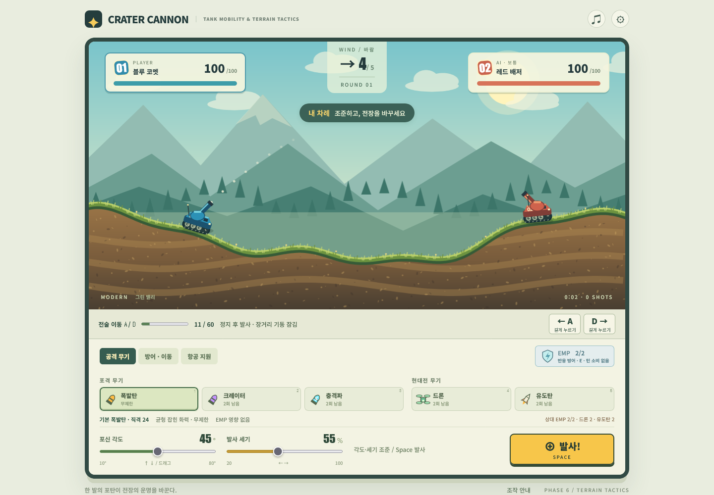
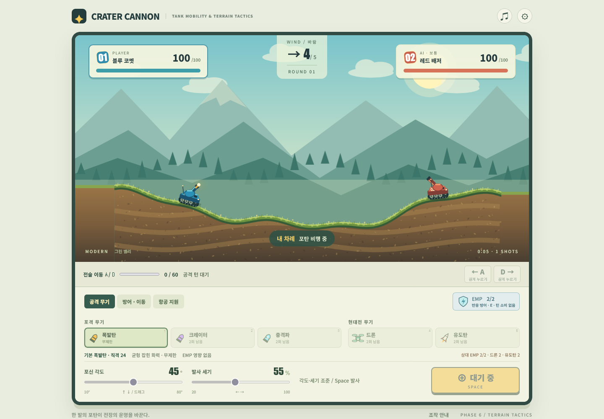
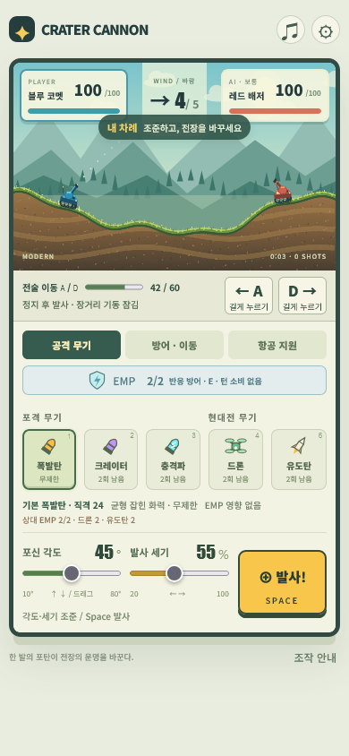

# Phase 6 — TANK MOBILITY & TERRAIN TACTICS

버전 1.5.0 · 완료 2026-11-23 (측정 11월 22일)

## 1. 주요 개선

공격 턴에 짧게 위치를 바꾼 뒤 발사하는 전술 이동을 추가했다. 기존 145 장거리 이동과 4개 캠페인·자유 전투·시대별 장비·기록을 유지한다. 새로운 무기나 전투 자원은 추가하지 않았다.

## 2. 단거리 이동

A/D 또는 길게 누르는 좌우 버튼으로 이동한다. 정상 자기 공격 턴마다 총 60이며, 왕복도 실제 이동 거리의 절댓값을 누적해 차감한다. 키를 놓으면 위치는 즉시 멈춘다. 재입력은 남은 거리로 이어지고 다음 정상 자기 턴에만 60으로 초기화한다. 실패한 이동 입력은 거리를 쓰지 않는다.

이동에 성공한 턴에는 장거리 이동을 사용할 수 없다. 기존 장거리 이동은 최대 145를 연속 이동하고 공격 턴을 소모한다. 항공 지원 대응 턴에는 단거리를 금지하고 기존 장거리 이동·정비·방어·공격 중 한 행동을 유지한다.

## 3. 정지 후 발사

움직이는 동안 포격·드론 출격·지원 요청을 막는다. 정지 후에는 탄약이나 공격 기회를 추가로 소모하지 않고 발사한다. 엔진의 기존 launch 함수가 변경된 실제 x/y에서 포구를 계산한다. 포신은 월드 각도로 그려 차체 경사와 탄도 각도가 섞이지 않는다. 잔여 넉백 속도가 단거리 예산에 포함되지 않은 추가 이동을 만들지 않도록 입력 시작 시 작은 잔여 수평 속도를 제거한다.

## 4. 지형과 충돌

1/120초 고정 스텝과 0.5 단위 경로 샘플을 사용한다. 전방만이 아니라 양쪽 궤도와 중심을 검사하므로 큰 이동 요청도 벽·차량을 건너뛰지 않는다. 경계 35~1245, 차량 간격 최소 68, 국소 단차 및 궤도 폭 경사 제한을 공유한다.

완만한 오르막은 감속하며, 내리막과 얕은 크레이터에서는 기존 지면 지지 높이를 따라간다. 급경사·절벽·깊은 크레이터 벽은 이유를 표시하고 정지한다. 지형 파괴 직후 공중에 있거나 큰 넉백 중이면 먼저 안착해야 한다. 지형 위 점선은 남은 예산·장애물·차량을 반영해 매 프레임 다시 계산한 도달 범위다.

## 5. 애니메이션·사운드·카메라

실제 부호 있는 이동량으로 바퀴 살과 궤도 링크를 회전시킨다. 후진은 역회전하며 정지 시 멈춘다. 기존 경사·반동에 차체 서스펜션 흔들림을 더했다. WWII는 가속 160, 현대는 230이며 동일한 최고 속도 64와 거리 60을 사용한다. WWII 차체 진동과 먼지는 더 무겁고 현대는 부드럽다.

먼지는 이동량·정지 후 짧은 잔상으로 표현하고 들판·모래·잔해 지형 색상을 구분한다. 엔진 음향은 단일 루프를 재사용하고 시동·정지 음을 더했다. 정지·일시정지·음소거에서 루프를 종료하고 누적 재생하지 않는다.

기존 카메라는 전장 전체와 양 차량을 포함한다. 이동 때문에 불필요한 팬이나 확대를 하지 않으며 포탄 추적에서 전체 화면으로 기존 보간을 유지한다. 화면 흔들림 설정도 그대로 적용한다.

## 6. AI 이동

공격 턴의 소비형 전술을 먼저 판단하고, 공격을 선택한 경우에만 짧은 이동을 검토한다. 쉬움/보통/어려움의 검토 확률은 12/32/55%, 목표 거리는 20/36/55다. 상대와의 거리, 높이, 어려움의 전방 지형 차폐를 평가하고 실제 통과 가능한 방향을 선택한다. 움직임은 플레이어와 같은 경로 검사·가속·거리 차감으로 진행한다.

최종 위치에 도착하거나 장애물에 막히면 기존 planAI를 한 번 호출해 다시 조준한다. 기존 난이도 오차·관측 보정은 유지한다. 이동 결정은 별도 시드 난수를 사용해 기존 공격 선택 난수열을 불필요하게 소모하지 않는다. 첫 라운드의 안내 공격, 지원 대응 턴, 강화 진지와 이동 금지 임무에는 단거리 이동을 적용하지 않는다.

동일 시드 31~40, 동일 플레이어 정책으로 측정했다. 각 행은 10경기이며 시간 초 / 라운드 / AI 명중률을 이전 → 현재로 비교한다.

| 시나리오    |   평균 초 | 평균 라운드 |     AI 명중률 | AI 단거리 이동 횟수 |  승리 |
| ----------- | --------: | ----------: | ------------: | ------------------: | ----: |
| normandy    |   53 → 55 |   8.2 → 8.3 | 34.8% → 38.2% |                   9 |  9/10 |
| iron        |   64 → 62 |  10.1 → 9.8 | 41.9% → 40.7% |                  12 | 10/10 |
| last-line   |   84 → 82 | 11.4 → 10.8 | 50.7% → 50.0% |                  14 |  9/10 |
| shadow      | 117 → 119 | 10.8 → 10.9 | 46.2% → 46.8% |                  16 | 10/10 |
| free-easy   | 101 → 102 |   8.8 → 8.9 | 24.2% → 28.4% |                   4 | 10/10 |
| free-normal | 105 → 115 |  9.6 → 10.2 | 43.5% → 47.8% |                  11 | 10/10 |
| free-hard   | 116 → 131 | 10.3 → 11.2 | 64.2% → 61.8% |                  24 | 10/10 |

70경기 모두 종료했으며 시간 초과와 40라운드 판정은 0건이다. 이동 횟수와 거리는 물리 고정 스텝마다 집계했다. 쉬움에서도 지형 변화로 일부 패배할 수 있으므로 이 표를 사람의 난이도 평가로 해석하지 않는다. [원본 측정](balance-phase6.json)과 [이전 측정](balance-phase5.json)을 함께 보존한다.

## 7. 기존 기능과 입력 호환

드론 상태에서는 WASD/방향키가 드론에 우선한다. 슬라이더·버튼·입력 필드·편집 영역은 일반 전차 단축키보다 우선한다. 키 해제, 창 blur, 포커스 변경, 숨김, 일시정지에 이동을 정지하고, 턴이 넘어갈 때 눌린 키를 비운다. 새로운 턴에 자동 반복 키가 이동을 재개하지 않는다.

터치 버튼은 pointer capture와 touch-action:none으로 누른 채 바깥으로 나가도 해제/취소를 처리한다. 안내는 별도 crater.hint.mobility 키를 사용한다. 저장 형식, 무기/지원 예산, EMP, 방어막, 수리, 장갑·진지, 캠페인 보상·해금·전환·기록은 유지한다.

## 8. 변경 파일

- src/game/engine.ts, movement.ts: 단거리 상태·공유 경로 검사·AI 단계·행동 제약.
- src/game/mobilityRenderer.ts, renderer.ts, campaignRenderer.ts, audio.ts: 궤도·차체·범위·먼지·엔진.
- src/components/Mobility.tsx, Arsenal.tsx, main.tsx, style.css: 게이지·키/포인터·장거리 구분·반응형 UI.
- src/game/phase6.test.ts, audio.test.ts, tests/mobility.spec.ts: 이동 물리·AI·실제 브라우저 입력 검증.
- scripts/balance-phase6.ts, docs/balance-phase6.json: 이전과 동일한 70경기 비교.
- README.md, package.json, package-lock.json, 이 보고서와 화면 증빙.

## 9. 테스트

- 단위 테스트: 7개 파일, **140개 통과**. 기존 113개와 이동·입력 제약·AI·먼지·엔진 루프 검증 27개.
- 프로덕션 빌드와 스모크 통과: 메뉴 → 발사 → AI 턴, 콘솔 오류 없음, 외부 요청 없음, 프로덕션 QA 브리지 제외.
- 브라우저 E2E: **19개 시나리오 검증**. 전체 실행 18개 통과 후, 바뀐 이동/지원 7개를 재검증했다. 최종 폭격 회피도 별도 통과했다.
- 기존 테스트의 포괄적인 “왼쪽 이동” 선택자는 단거리 버튼 추가로 모호해져 장거리로 명시했다. 크레이터의 급경사에서 이동이 약 49에 멈추는 상황은 피해 감소·3개 폭발·턴 순서를 검사하도록 보강했다. 평지에서 145를 이동해 회피하는 검증은 기존 단위 테스트에 유지한다.
- 키보드 A/D·해제·왕복 60·새 포구·턴 초기화, 드론 우선순위, 슬라이더 초점, Esc·blur, 포인터 바깥 해제, 390px 모바일 및 1366px 첫 화면을 확인했다.
- 4개 임무의 실제 연속 승리, 패배 재도전, 손상 저장 복구, 해금·보상·시대 전환, 3난이도 자유 전투, EMP·방어막·수리·항공 지원·고각 카메라·효과 정리·기록을 회귀 검증했다.
- 엔진 음향 테스트는 100회 속도 갱신에서도 루프 1개를 재사용하고 정지·음소거·일시정지에 해제되는지 확인한다.
- 70경기 밸런스 재현: 70경기 종료, 시간 초과 0, 라운드 제한 판정 0. GitHub Quality 워크플로는 커밋마다 전체 테스트를 다시 실행한다.

## 10. 브라우저 확인

사용자 브라우저의 http://127.0.0.1:4190/ 에서 실제 D 키를 길게 눌러 60 → 35로 이동 예산 감소, 해제 후 정지, 이동 뒤 발사와 1 SHOTS 증가를 확인했다. 별도 자동화는 새 포구 좌표·왕복 거리·턴 초기화·모바일 입력까지 읽기 전용 QA로 검증한다. 게임 상태나 승패를 주입하지 않는다.

## 11. 한계와 밸런스

2D 높이맵과 단순 서스펜션을 사용한다. 벽을 오르거나 깊은 절벽을 뛰어넘지 않으며 연료·다중 전차·실시간 이동·온라인·3D는 없다. 실제 키를 놓을 때 정확히 정지하는 조작을 우선하고 감속 느낌은 먼지·서스펜션·정지음으로 표현한다. 현재 풀뷰에서 양 전차가 항상 보여 별도의 차량 추적 카메라가 필요하지 않다.

자동 조준을 이용한 시뮬레이션 시간에는 사람이 생각하는 시간이 없다. 기존 3~5분 플레이 목표를 유지하지만 실제 사람의 평균 플레이 시간이나 난이도 검증으로 주장하지 않는다. 음향 동작은 코드·브라우저 실행을 검증했으며 다양한 실기기 스피커의 청감 평가는 수행하지 않았다.

## 화면 증빙

