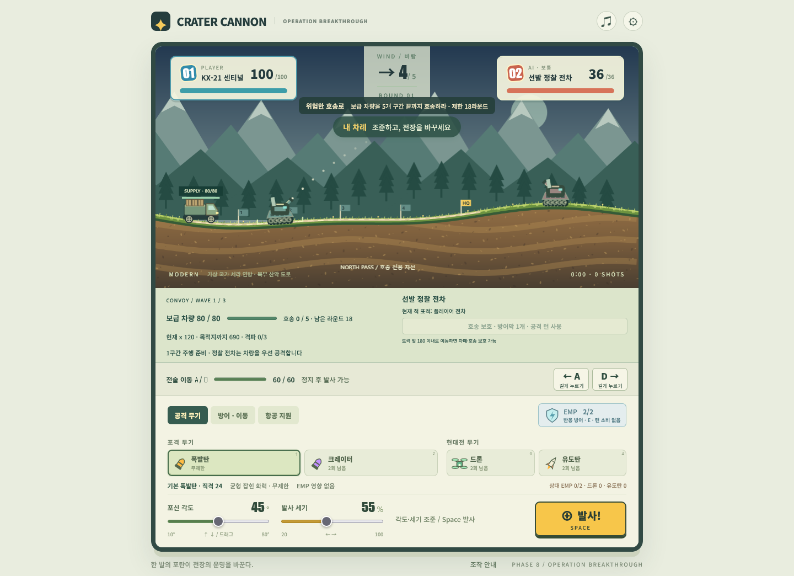
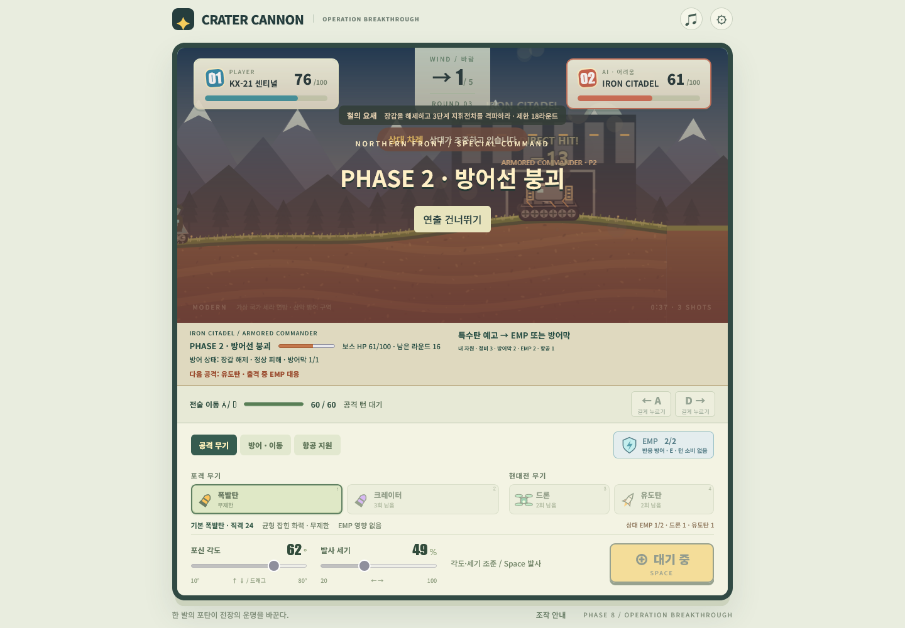

# Phase 8 — OPERATION BREAKTHROUGH

버전 1.7.0 · 2026-11-23

## 1. 확인한 기존 구현

Phase 7을 먼저 완료해 main의 d8ec8c2에 반영했다. 단위 168개·브라우저 22개·빌드·프로덕션 스모크와 GitHub Quality #45105855813이 통과했다. 시설 HP/충돌체/목표 판정/6개 임무/기존 저장 이전을 재사용해 확장했다. Phase 7 전체를 재작성하지 않았다.

## 2. 실제 신규 임무

7번 ‘위험한 호송로 / CONVOY UNDER FIRE’와 8번 ‘철의 요새 / IRON CITADEL’을 추가했다. 레이더 무력화 → 보급차 북부 진입 → 호송 성공 → 핵심 방어 구역 돌파 → 북부 작전 종료로 연결된다. 각각 보급 450/550, 전체 8개 최초 완료 합계 2550이다.

## 3. 호송 차량

독립 HP 80의 비무장 보급차가 x=120에서 220/350/490/650/810의 5개 체크포인트를 진행한다. 양측 행동이 끝난 라운드 경계에서 이동하고, 각 구간은 1.6초 주행 애니메이션을 사용한다. 통로의 위협 제거 조건은 순서대로 격파 수 0/1/1/2/3이다.
보강된 전용 차선은 출격 시 높이맵을 보존한다. 포격된 구간에는 교량 지지대를 그려 주행을 유지하고, 플레이어의 지형·이동은 계속 파괴된 지면을 따른다. 복잡한 자유 경로 탐색과 차선 간 차량 충돌은 하지 않는다. 보급차 자체는 실제 포탄·유도탄·드론·범위 피해 충돌 대상이며 아군 공격에도 피해를 받는다.
플레이어가 트럭 앞 180 이내에 있으면 적 피해를 25% 줄인다. 그 위치에서 방어막 1개와 공격 턴을 써 ‘호송 보호’를 전개하면 다음 적 공격의 트럭 피해를 추가로 절반 감소시킨다. EMP도 트럭을 향한 적 전자 공격에 대응할 수 있다.
차량과 플레이어 생존 상태로 마지막 구간 도착 시 성공한다. 차량/플레이어 파괴 또는 18라운드 제한은 실패다. 첫 적 격파만으로 승리하지 않는다.

## 4. 순차 적 증원

정찰 HP 36/장갑 0 → 차단 HP 46/장갑 8% → 지휘 HP 60/장갑 18%의 3개 웨이브다. 마지막 적만 드론·유도탄 각 1회, 방어막·EMP 각 1개를 가진다. x=1060/1080/1100에 등장하며 실제 지형 위에 안착한다.
포탄·드론·지원의 실제 피해와 종료 처리가 끝난 턴 경계에서 적 객체만 교체한다. 플레이어 HP·탄약·정비·방어·지원·전투 통계를 유지한다. 등장 경고 동안 전투 입력을 막고 건너뛸 수 있다. 새 적이 즉시 공격하거나 추가 턴을 얻지 않는다.

## 5. 보스 3단계

보스 HP는 일반 전차와 같은 100이다. 별도 차체·충돌 크기와 상태 규칙으로 구분한다.
1단계 강철 장갑은 피해 45% 감소. 유효 공격 3회, HP 60 이하, 기초 지형 높이 변화 15, 플레이어 x≥550 전진 중 하나가 행동 종료 시 장갑을 해제한다. HUD와 브리핑에 약점을 안내한다.
2단계는 장갑을 제거하고 유도탄·드론 각 1회를 사용한다. 실제 발사 무기를 경고하며 기존 4초 EMP 대응 창과 탄도를 사용한다.
HP 35 이하의 3단계는 폭격 지원을 한 번 요청한다. 구역 예고와 플레이어 대응 행동 후 기존 공중 지원 물리로 처리한다. 이동·방어막으로 대응할 수 있으며 자동 명중이나 추가 공격 턴이 없다. 이후 남은 특수탄·크레이터·일반 포격을 사용한다. 보스 방어막은 한 개, 정비는 없다. 단계는 되돌아가거나 중복 전환되지 않는다. 플레이어 파괴가 동시 보스 격파보다 우선하며 제한은 18라운드다.

## 6. 그래픽·시네마틱

산악 도로/침엽수/설산 배경, 보급 물자와 트럭, 회전 바퀴·주행 흔들림·먼지·피해 연기·목적지 깃발·교량을 Canvas로 그린다. 보스는 넓은 궤도, 장갑 패널, 이중 전자 장비 포드, 두꺼운 포신과 파손선을 가진다. 카드와 브리핑에도 새 SVG 일러스트를 넣었다.
보스 등장·단계 전환·최종 격파에서 짧은 카메라 확대/오른쪽 초점·색감·경고음·무전을 사용한다. 등장 2.5초, 단계 1.6초, 최종 격파 2초이며 모두 건너뛸 수 있다. 격파 연출은 실제 지형 파괴와 연결되고 연출 종료 후 결과를 기록한다. 외부 유료 이미지/음원 서비스는 쓰지 않는다.

## 7. AI·밸런스

정찰은 플레이어, 차단은 보급차, 지휘는 난이도와 공개 상태에 따른 두 표적 선택을 사용한다. 기존 AI 오차·관측 착탄 보정·지형·이동 규칙을 유지한다. 신규 웨이브는 정비하지 않으며 드론/미사일/방어 자원이 제한된다.
고정 시드와 공통 탄도 솔버에 각도 ±2/세기 ±3 오차를 넣어 난이도별 방어 활용 정책과 공격 전용 정책을 비교한다. 이는 자동 정책의 성공 가능성 측정이며 인간 플레이 난이도나 실제 조준 시간을 뜻하지 않는다. 상세 결과는 [balance-phase8.json](balance-phase8.json)에 남겼다.

90판에서 무한 진행 0건이다. 방어 활용은 각 난이도 10판, 공격 전용은 공통 시드 첫 5판이며 표본 수가 다르다.

| 임무·난이도 | 방어 활용 승리 | 공격 전용 승리 | 평균 엔진 시간(초), 방어/공격 |
| ----------- | -------------- | -------------- | ----------------------------- |
| 호송 easy   | 10/10          | 5/5            | 164 / 132                     |
| 호송 normal | 7/10           | 5/5            | 133 / 138                     |
| 호송 hard   | 6/10           | 4/5            | 144 / 133                     |
| 보스 easy   | 10/10          | 5/5            | 117 / 123                     |
| 보스 normal | 10/10          | 4/5            | 104 / 109                     |
| 보스 hard   | 10/10          | 2/5            | 126 / 111                     |

호송에서는 특정 보호 전략이 항상 최선은 아니며, 공격 지연으로 적에게 행동 기회를 줄 수 있다. 차폐 위치·보호 시점·남은 트럭 HP를 함께 판단해야 한다. 보스의 어려움에서는 방어 활용 10/10과 공격 전용 2/5로 전략 차이가 나타났다. 이 수치는 자동화 정책의 결과다.

## 8. 저장·해금·평가

crater.campaign.v1과 이전 완료·등급·보급·시대 전환 기록을 유지한다. 기존 6개 완료/1550점에서 7번만 추가 해금한다. 7번 성공 후 8번, 전체 완료 후 2550점을 기록한다. 임무 배열 길이를 쓰며 선행 임무를 임의 완료 처리하지 않는다. 재도전은 보급을 중복 지급하지 않고 최고 등급을 유지한다.
호송은 트럭/플레이어 HP·라운드·격파 수, 보스는 남은 HP·라운드·약점 활용·방어 사용을 S/A/B에 반영한다. 실패·재도전에서는 출격 자원을 초기화하고 획득 기록은 보존한다.

## 9. 주요 파일

- src/game/operations.ts: 체크포인트·웨이브 데이터, 보스 상태, 호송 판정
- src/game/engine.ts, objectives.ts, eras.ts: 기존 물리/턴과 상태 전환 연결
- src/game/campaign.ts, campaignStorage.ts: 7~8번 이야기·저장·평가
- src/game/operationRenderer.ts, campaignRenderer.ts, facilityRenderer.ts, renderer.ts, audio.ts: 차량·전장·연출
- src/components/BreakthroughHUD.tsx, BreakthroughArt.tsx, Campaign.tsx, src/main.tsx, style.css: HUD·목표·결과
- src/game/phase8.test.ts, tests/breakthrough.spec.ts, scripts/balance-phase8.ts: 자동 검증

## 10. 빌드·테스트

단위 테스트 195개(9개 파일), 전체 Firefox E2E 25개, TypeScript·프로덕션 빌드, 프로덕션 스모크가 모두 통과했다. 전체 E2E는 로컬에서 11.8분이 걸렸다. 스모크는 메뉴·발사·AI 턴·브라우저 오류 없음·외부 요청 없음·프로덕션 QA 브리지 제외를 확인했다. 고정 시드 90판에서 진행 정지는 0건이다. 최종 JS 번들은 약 384.59 kB(gzip 124.35 kB)다. 기존 테스트는 보존하고 캠페인 표시의 전체 개수만 8개에 맞췄다. 이전 balance-phase7 스크립트는 기존 6개 임무를 고정해 과거 비교 기준을 유지한다.

## 11. 브라우저 플레이 검증

Playwright Firefox에서 실제 UI 입력·공통 물리로 7→8 연속 승리, 보급차 파괴 실패, 보스 패배, 재도전, 새로고침 후 저장 유지, 모바일 HUD 검증을 통과했다. 보스는 1→2→3 단계를 거쳐 실제 폭격 1회와 피해 상한 30을 확인했고, 8개 완료/2550점 저장을 확인했다. 읽기 전용 QA로 상태를 관찰하고 선행 완료 저장만 fixture로 설정한다. 브라우저에서 HP·피해·위치·승패를 주입하지 않는다. 이 결과는 자동화한 실제 브라우저 검증이며 수동 인간 플레이 평가와 구분한다. 화면 기록은 docs/screenshots/phase8-*.png에 저장한다.

[호송 성공](screenshots/phase8-convoy-victory.png) · [보스 격파](screenshots/phase8-boss-victory.png) · [호송 실패](screenshots/phase8-convoy-failure.png) · [보스 실패](screenshots/phase8-boss-failure.png) · [모바일](screenshots/phase8-mobile-boss.png)

## 12. 범위와 제한

순차 웨이브 한 대만 활성화한다. 트럭은 보강된 고정 체크포인트 차선으로 이동하며 자유 경로 탐색/차량 간 추월 충돌/차선 붕괴를 구현하지 않는다. 보스 약점은 가상의 게임 규칙이다. 온라인 멀티플레이·실시간 RTS·대규모 무기/경제·3D·새 시대는 추가하지 않았다. 캠페인 후속 미구현 임무를 출격 가능하게 표시하지 않는다. 현재 자동 검증에서 남은 오류는 발견되지 않았다. 실제 모바일 하드웨어 성능과 인간 조준을 포함한 권장 4~7분 플레이 시간은 별도 사용자 평가가 필요하다.
