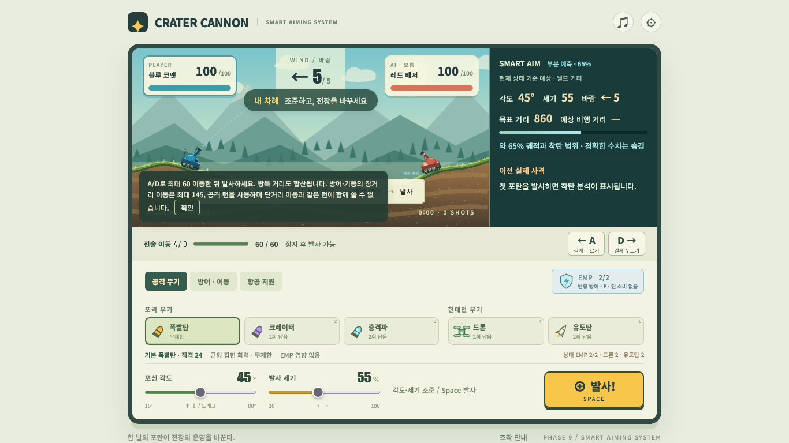
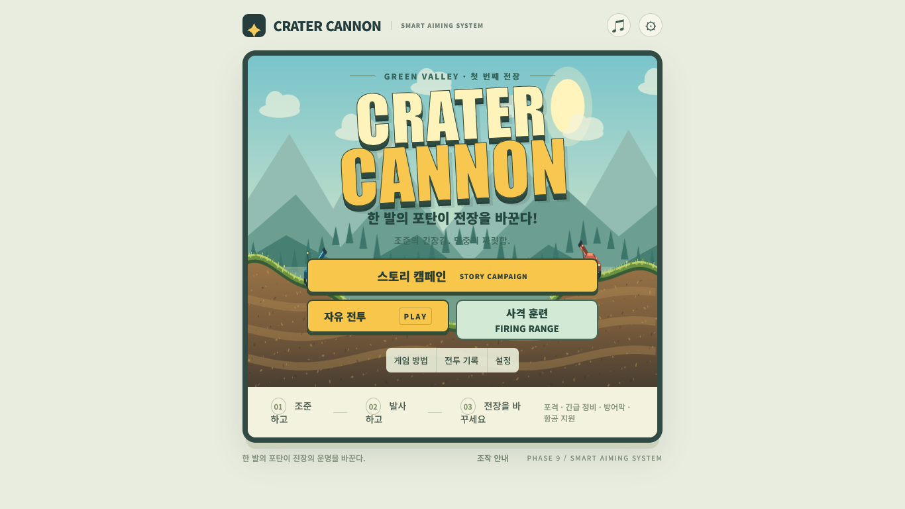
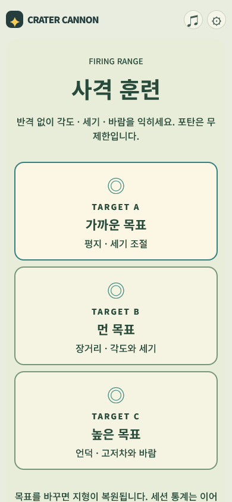
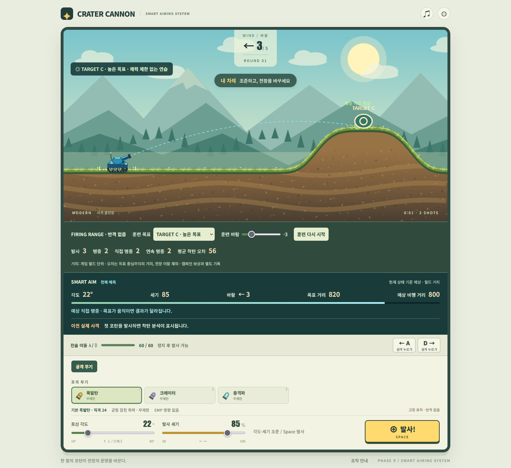
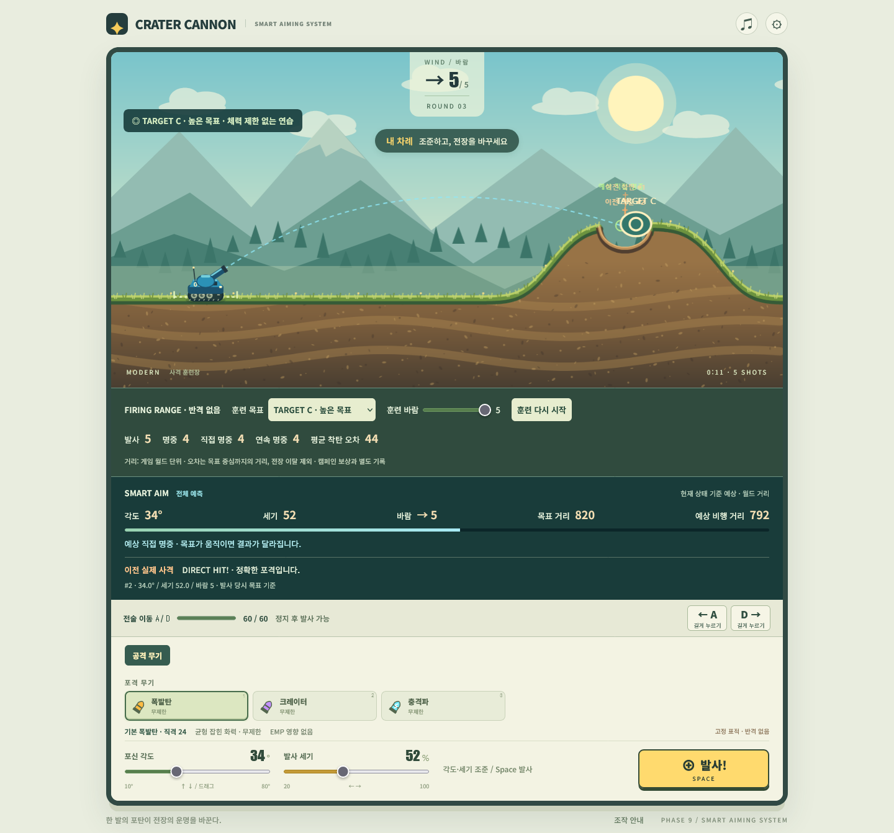
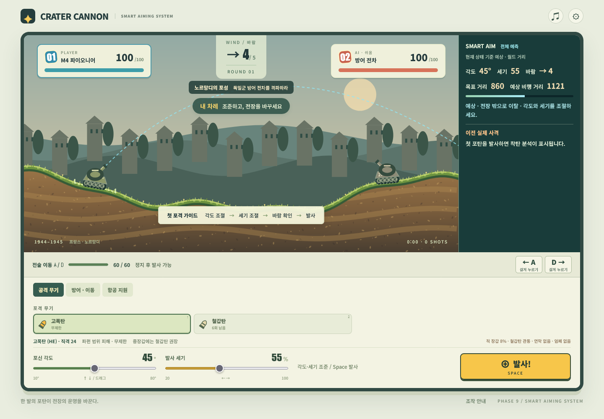
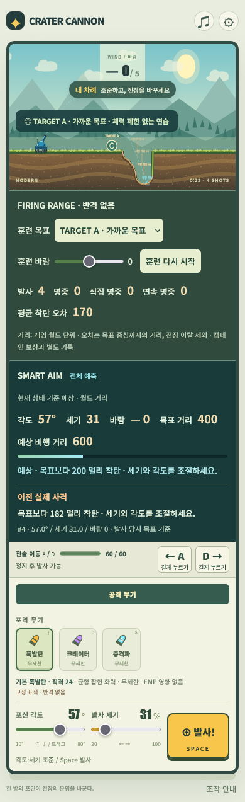

# PHASE 9 — SMART AIMING SYSTEM

기반: Phase 8 v1.7.0 / 결과: **v1.8.0** / 검증일: 2026-11-23

## 1. 기존 조준 문제와 수정

기존 `Renderer.guide()`는 매 프레임 75 STEP(0.625초)만 적분해 착탄 지점까지 볼 수 없었습니다. `lastImpact`는 엔진 내부에만 있었고 세기와 사거리의 관계를 설명하지 못했습니다. 이번 변경은 별도의 순수 예측기와 캐시, 조준 HUD, 실제 사격 이력, 반격 없는 사격 훈련장을 추가합니다. 8개 캠페인·무기 피해량·AI 공격 정확도는 유지합니다.

## 2. 예상 궤적 계산

`aimPrediction.ts`가 현재 포구에서 `launch()`로 독립 포탄을 만듭니다. 실제 사격의 `advance()` 또는 `advanceMissile()`를 STEP=1/120로 호출하며 바람, 중력, 현재 지형과 전차·시설의 실제 충돌 크기를 공유합니다. 지면·차량·시설 충돌, 전장 이탈, 엔진의 12초 제한에서 종료하며 안전 상한은 1,441 STEP입니다. 렌더링용 좌표는 8 STEP마다 보관하고 마지막 충돌점은 반드시 포함합니다.

HP·탄약·통계·시간·지형·목표 상태·게임 난수는 예측에서 변경하지 않습니다. `solveShot()`는 기존 AI와 자동화 테스트 플레이어가 사용하며 플레이어의 조준 UI에는 연결하지 않았습니다.

## 3. 실제 착탄과의 일치

단위 테스트에서 폭발탄·철갑탄·크레이터탄·충격파탄과 바람 -5/0/+5의 표본 경로와 최종 충돌 좌표를 실제 적분 결과와 비교합니다. 차량, 시설, 대형 보스 충돌 크기, 이동 후 새 포구, 지형 변경도 검증합니다.

Firefox에서 UI로 실제 5발을 발사해 발사 전 예측과 착탄 후 이력을 비교했습니다. 3종 표적, 평지·고저차, 바람 0/-3/+5를 포함하며 **5발 모두 좌표 오차 0**이었습니다. 단순히 계산기를 두 번 호출한 결과가 아니라 실제 `Battle.fire()`와 프레임 루프의 결과입니다.

| 발사 | 목표      | 각도 / 세기 | 바람 | 실제 결과 | 좌표 오차 |
| ---- | --------- | ----------- | ---- | --------- | --------- |
| 1    | A 가까움  | 45° / 25    | 0    | 지면      | 0         |
| 2    | A 가까움  | 74° / 40    | 0    | 표적 직격 | 0         |
| 3    | B 멀리    | 34° / 49    | 0    | 표적 직격 | 0         |
| 4    | C 높은 곳 | 22° / 85    | -3   | 표적 직격 | 0         |
| 5    | C 높은 곳 | 34° / 52    | +5   | 표적 직격 | 0         |

원시 좌표: [accuracy-phase9.json](accuracy-phase9.json). 실제 비행 중 대상·바람·지형이 변하거나 연막 오차가 적용되면 일치를 보장하지 않습니다.

## 4. 착탄 기록과 오차 분석

플레이어의 실제 발사 직후 각도·세기·바람·출발점·포구·목표 스냅샷을 저장합니다. 연막이 있다면 실제 오차 적용 후 값을 기록합니다. `finishAttack()`에서 `lastImpact`와 같은 충돌 결과, 실제 피해에 의한 명중 여부를 붙입니다. 일반 포탄 최근 3발과 드론·유도탄 최근 3발은 별도 배열이며 AI 포탄을 섞지 않습니다.

주황색 십자와 번호는 실제 월드 좌표를 유지합니다. 지형이 바뀌어도 마커 라벨을 현재 지표면 위에 두고 실제 좌표까지 선을 잇습니다. 오래된 기록은 흐리게 표시합니다. 직격, 근접, 짧음, 멀음, 높은 지형 차단, 다른 차량·시설 차단, 전장 이탈, 착탄 없는 종료를 구분합니다. 고지 차단에는 세기 증가를 단정하지 않고 높이·방향 확인을 안내합니다. 원인 분류는 발사 당시 목표와 충돌 높이·수직 속도를 이용한 설명용 휴리스틱이며 정답 조준값은 제공하지 않습니다.

## 5. 세기·사거리 UI

PC에서는 전장 오른쪽, 훈련장과 작은 화면에서는 무기 패널 위에 현재 각도·세기·바람·목표 수평 거리·예상 비행 거리·직전 사격 분석을 표시합니다. 세기 게이지는 입력값에 따라 부드럽게 바뀝니다. 비행 거리는 예측 종료점과 출발점의 수평 차이이며 세기만으로 만든 임의 공식이 아닙니다. 모든 거리는 캔버스 픽셀이나 실세계 미터가 아닌 게임 월드 단위입니다.

하늘색 점선은 예상, 주황색은 실제 기록, 녹색과 문구는 예상 직격, 경고 표시는 차폐입니다. 카메라는 표시되는 탄도 구간의 높이를 고려해 고각 궤적을 보여줍니다. 드론의 기존 수동 UI는 유지하며 유도탄은 처음 0.625초 이하만 표시하고 고정 착탄점은 보여주지 않습니다. 연막은 초기 방향만 표시하고 정확한 수치·착탄 마커를 숨깁니다.

## 6. 난이도별 조준 보조

| 모드        | 예상 궤적 | 예상 착탄                                     | 실제 이력 |
| ----------- | --------- | --------------------------------------------- | --------- |
| 쉬움 기본   | 전체      | 정확한 위치·거리                              | 최근 3발  |
| 보통 기본   | 약 65%    | 50단위로 양자화한 범위 중심, 정확한 수치 숨김 | 최근 3발  |
| 어려움 기본 | 짧은 방향 | 숨김                                          | 최근 3발  |
| 끄기        | 숨김      | 숨김                                          | 유지      |
| 확장        | 전체      | 정확한 위치·거리, 특수·연막 예외 유지         | 유지      |

기본 가이드는 `Battle.difficulty`를 사용하므로 자유 전투 설정이 어려움이어도 쉬움 캠페인에는 전체 가이드가 적용됩니다. 설정은 즉시 반영하고 저장합니다. 확장을 한 번 사용한 경기는 이후 꺼도 보조 사용 표시를 유지합니다. 자유 전투 결과와 기록에 표시하며 캠페인은 완료 임무의 보조 사용 이력을 저장합니다. 보급·피해·등급 공식에는 보정을 넣지 않았습니다.

## 7. 사격 훈련장

메인 메뉴의 **사격 훈련 / FIRING RANGE**에서 A(가까운 평지), B(먼 평지), C(높은 언덕)를 선택합니다. 하나의 고정 표적을 선택하는 방식이며 기존 충돌 크기의 연습 표적을 그립니다. 새 캠페인 임무나 전차는 추가하지 않습니다.

기존 Battle을 사용하고 AI 반격·승패·플레이어 피해를 적용하지 않습니다. 표적 HP는 사격 처리 후 복원하고 폭발 밀림은 적용하지 않습니다. 폭발탄·크레이터탄·충격파탄은 무제한이며 실제 지형 파괴는 유지합니다. 발사·명중·직격·연속 명중·최고 연속·평균 착탄 오차를 집계합니다. 평균 오차는 착탄점부터 발사 당시 목표 중심까지의 거리이며 이탈·아직 비행 중인 포탄은 제외합니다. 직격도 표적 외곽에 충돌하므로 중심 오차가 0일 필요는 없습니다.

표적 변경은 지형과 마커를 초기화하고 통계·조준값을 유지합니다. 다시 시작은 새 세션, 메뉴 복귀·표적 변경·재시작 시 별도 `crater.training.v1` 저장소에 최근 10세션을 저장합니다. 캠페인 보급이나 자유 전투 기록을 변경하지 않습니다.

첫 진입에는 ① 각도 고정·세기 조절 ② 세기 고정·각도 조절 ③ 바람 +3 및 고지 표적 비교의 짧은 학습을 제공합니다. 언제든 학습을 건너뛰고 자유 연습을 할 수 있습니다. 학습 완료는 별도 키에 저장합니다.

## 8. 성능 최적화

Renderer와 React HUD가 같은 `PredictionCache`를 사용합니다. 무기·각도·세기·바람·포구 위치·지형 revision·목표 선택·연막·모든 충돌체의 위치/HP/크기가 같으면 재계산하지 않습니다. 이동 중에는 현재 위치로 갱신하고 정지 후 오래된 포구를 재사용하지 않습니다. 경로는 전 스텝을 저장하지 않고 다운샘플링합니다.

Windows Node 24.14.0의 400회 변경 조건 마이크로벤치마크: 중앙값 **0.619ms**, 95백분위 **1.477ms**, 최대 **3.087ms**. 표본 최대 703 STEP/90좌표. 같은 조건 20,000회 캐시 조회에서 계산 1회, 조회 합계 약 32.87ms. [원시 성능 자료](performance-phase9.json), 재현: `npx tsx scripts/benchmark-aim.ts`. 이 값은 실제 모바일 기기의 FPS 측정값이 아닙니다.

## 9. 주요 파일

- `src/game/aimPrediction.ts`: 실제 물리 기반 예측·난이도 정책·캐시.
- `src/game/shotHistory.ts`: 실제 사격 메타데이터와 설명 분류.
- `src/game/training.ts`: 훈련 설정·목표·통계·별도 저장.
- `src/game/engine.ts`: 실제 발사/종료 기록, 훈련 턴 처리, 보조 사용 결과.
- `src/game/renderer.ts`: 예상/실제 마커·카메라·훈련 표적.
- `src/components/AimingHUD.tsx`, `TrainingMenu.tsx`: 조준 및 훈련 UI.
- `src/main.tsx`, `Arsenal.tsx`, `style.css`: 모드 진입·설정·학습 잠금·반응형 표시.
- `storage.ts`, `campaignStorage.ts`, `Campaign.tsx`: 설정과 보조 사용 이력 호환 저장.
- `aimPrediction.test.ts`, `tests/aiming.spec.ts`, `scripts/smoke.mjs`: 정확도·실제 브라우저·프로덕션 검증.

## 10. 자동화 테스트

- `npm test`: **230개 통과 / 10파일**. 기존 197개 유지, 신규 33개.
- `npm run build`: TypeScript와 Vite 성공. JS 400.78kB / gzip 129.80kB, CSS 43.47kB / gzip 10.15kB.
- `npm run test:smoke`: 실제 프로덕션 빌드에서 메뉴·발사·AI 턴·훈련 사격·착탄 이력 성공. 페이지 오류·외부 요청 없음, QA 브리지 제외 확인.
- 신규 E2E 4개 통과: 5발 좌표 비교, 학습·모드·저장·이동·가이드 설정, 390×844 모바일 4발과 최근 3개 이력, PC/모바일 메뉴 버튼의 경계 검사.
- 기존 25개 E2E를 유지해 총 29개입니다. 로컬 전체 실행에서 발견한 카메라·배치 회귀를 수정한 뒤 자유 전투 6개, 이동 3개, 새 조준 4개의 재검증이 통과했습니다. 전체 세트의 최종 실행 결과는 [GitHub Quality](https://github.com/benochansong/Crater-Cannon/actions/workflows/quality.yml)에서 확인할 수 있습니다.

## 11. 실제 브라우저 검증

실제 Firefox를 Playwright로 조작했습니다. DOM 슬라이더·버튼·키보드를 사용하고 읽기 전용 QA 스냅샷으로 관찰했습니다. 테스트 플레이어가 사격값을 선택하기 위해 기존 `solveShot()`를 호출하지만 엔진 상태·HP·명중 결과를 주입하지 않습니다. 수동 사람 플레이나 실제 휴대전화 검증으로 보고하지 않습니다.

## 12. 남은 제한과 제외 기능

- 예측은 현재 상태 스냅샷입니다. 움직이는 표적의 미래 위치나 실제 연막 난수까지 확정하지 않습니다.
- 보통 난이도의 착탄 범위는 난이도 안내용 범위이며 통계적 확률 구간이 아닙니다.
- 지형 차단 원인 안내는 높이·충돌 방향을 이용한 휴리스틱입니다. 자동 정답이나 피해 보정을 제공하지 않습니다.
- 훈련장은 표적 하나를 선택하는 방식이고 전환 시 지형/마커를 초기화합니다. 비행 중 표적·바람 변경은 잠그며 재시작·메뉴 복귀는 가능합니다.
- 세션 저장은 명시적인 메뉴 복귀·표적 변경·재시작 시 수행합니다. 탭을 강제 종료하기 직전의 저장을 보장하지 않습니다.
- 실제 모바일 하드웨어의 프레임 속도·장시간 메모리 프로파일, 사람의 학습 효과는 측정하지 않았습니다.
- 새 무기·전차·임무·멀티플레이·자동 조준·자동 발사·공격력 강화는 이번 범위에서 제외했습니다.
