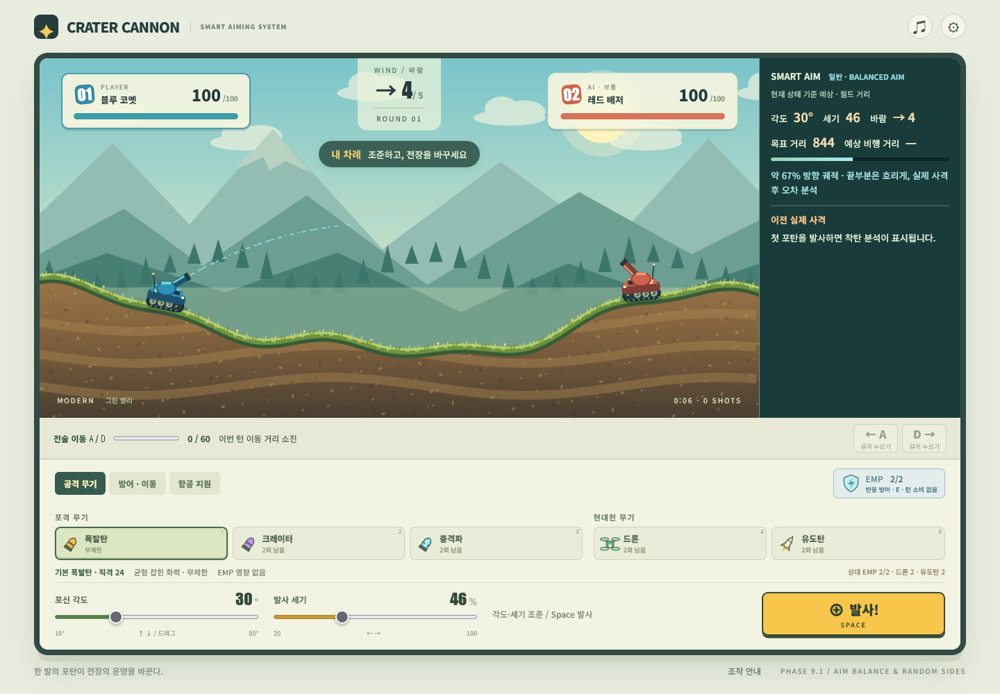
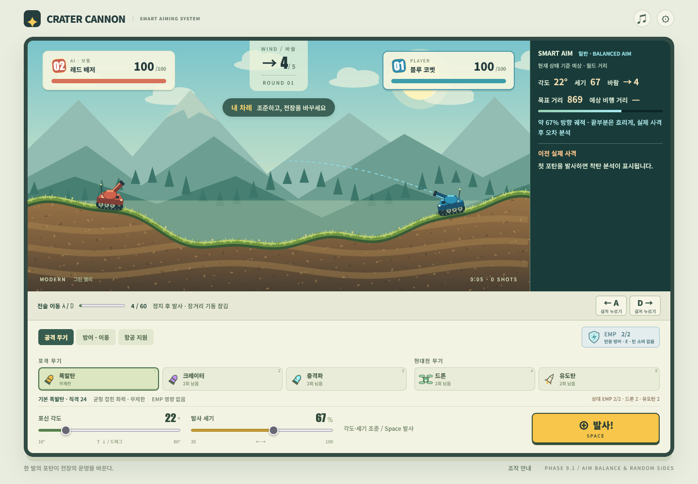
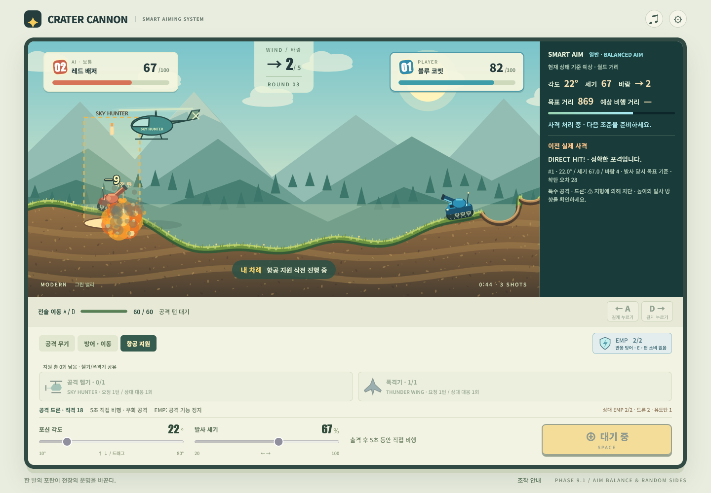
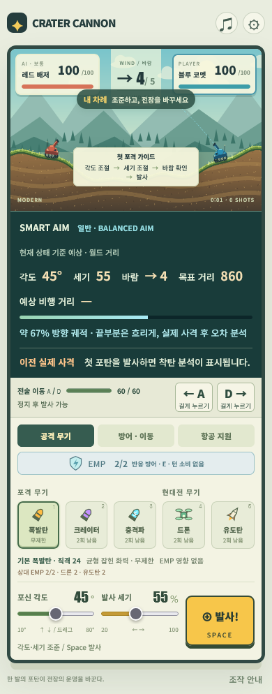

# PHASE 9.1 — AIM BALANCE & RANDOM SIDES

기반: v1.8.0 / 결과: **v1.8.1** / 검증일: 2026-11-23

## 1. 조준 보조 시스템 변경

일반 전투의 기본 보조를 `balanced`로 바꾸고 AI 난이도와 분리했습니다. 일반·초보자·숙련자·끄기 네 가지 선택을 즉시 적용합니다. 예측은 실제 `launch/advance/advanceMissile`을 공유하는 순수 계산으로 유지하고 화면에 제공하는 정보만 제한합니다. 플레이어 자동 조준·자동 발사는 추가하지 않았습니다.

## 2. 일반 조준 모드의 실제 동작

일반 포탄은 계산된 비행 시간의 약 67%까지만 하늘색 점선으로 표시합니다. 뒤쪽 절반부터 투명도를 낮추고 마지막 표본은 4%까지 흐려집니다. 충돌 전 최소 0.35초, 착탄점 및 목표 중심과 100 월드 단위의 간격을 확보하므로 짧거나 가까운 비행에서는 67%보다 짧게 보이거나 표시할 안전 구간이 없을 수 있습니다.

일반 모드에는 예상 착탄점, 범위 원, 직접 명중 문구·색, 정확한 미래 비행 거리와 오차가 없습니다. 현재 각도·세기·세계 좌표 기준 바람·목표까지의 거리와 실제 발사 후 분석은 유지합니다. 카메라도 표시가 허용된 궤적만 사용합니다. 초보자는 전체 예측, 숙련자는 최대 75 STEP(0.625초)의 방향 가이드, 끄기는 예상선 없음입니다. 연막 불확실성과 유도탄 초기 구간·드론 수동 조작 예외는 유지합니다.

월드에는 최근 실제 착탄 **1발**만 작은 주황 십자와 “이전 탄”으로 표시합니다. 일반 포탄 데이터 최근 3발과 특수 무기 기록은 유지합니다. 직전 발사의 각도·세기·바람·실제 충돌 원인·목표 중심 기준 오차는 HUD에 남습니다.

## 3. 기존 설정값 마이그레이션

| 기존 값                          | 적용 값        |
| -------------------------------- | -------------- |
| `default`, 누락, 잘못된 값       | `balanced`     |
| `extended`                       | `beginner`     |
| `off`                            | `off`          |
| `balanced`, `beginner`, `expert` | 명시한 값 유지 |

난이도·음량 등 다른 설정은 유지합니다. 읽기 실패·깨진 JSON은 기본 설정으로 복구하고 저장소 접근·할당량 오류는 게임을 중단하지 않습니다. 초보자 전체 보조를 사용한 경기의 표시와 기존 `assisted` 저장 형식도 유지합니다.

## 4. 자유 전투 진영 랜덤화

경기 seed를 별도 정수 해시로 변환해 32비트 공간의 절반을 왼쪽, 절반을 오른쪽에 배정합니다. 지형·AI·바람의 난수 스트림을 소비하지 않으며 같은 시드는 같은 배치입니다. 일반 게임의 시작·재시작은 새 시드를 생성합니다. 무조건 좌우 교대하는 방식이 아닙니다.

테스트 모드에서만 `?seed=31&side=left` / `side=right`로 강제 재현합니다. 배포 빌드에서는 URL 제어와 읽기 전용 QA 객체를 제외합니다. 1만 개 시드의 결과는 왼쪽 **5,088회(50.88%)**, 오른쪽 **4,912회(49.12%)**였습니다. 분포와 AI 비교 원시 자료는 [balance-phase9_1.json](balance-phase9_1.json), 재현 명령은 `npx tsx scripts/balance-phase9_1.ts`입니다.

## 5. 포신 및 발사 방향

전차의 소유 팀(`side`)과 바라보는 방향(`facing: 1 | -1`)을 분리했습니다. 상대와의 실제 x 좌표 차이로 방향을 갱신합니다. 포구 x, 포탄 수평 속도, 포신 회전, 반동, 발사 섬광이 이 방향을 공유합니다. 양쪽 모두 10~80도의 양수 고각과 동일한 세기·중력 규칙을 사용합니다. 오른쪽 플레이어의 드래그는 왼쪽 표적 방향을 양의 전방 거리로 변환합니다.

## 6. 양방향 AI 조준

AI의 실제 탄도 탐색은 목표 방향을 사용하는 포구·발사 함수를 호출합니다. 이전 탄의 월드 좌표 오차는 발사 방향을 적용해 짧음/멀음으로 정규화한 뒤 보정합니다. 어려움의 이동 후보 평가도 전방 지형을 `x + facing * 50`으로 확인합니다. 기존 난이도별 각도·세기 오차, 무기 선택, 피해량은 유지합니다.

대칭 지형·반대 바람·동일 시드 오차를 사용하는 30쌍 × 3난이도 AI 사격 감사를 수행합니다. 90쌍 모두 조준값이 같고 난이도별 직격 횟수도 양쪽이 같았습니다. 최대 대칭 착탄 오차는 **9.50×10⁻¹² 월드 단위 미만**입니다. 이 검사는 물리와 AI 보정의 좌우 공정성을 검사하며 사람의 진영별 승률을 측정하는 실험은 아닙니다.

## 7. 지형과 바람 처리

오른쪽 배치에서는 길이 1281의 실제 heightmap을 뒤집고 전차 시작 x를 `WIDTH - x`로 변환합니다. `originalTerrain`도 반전한 데이터에서 복사하고 전차의 지지 높이를 다시 계산합니다. 화면 전체를 뒤집지 않습니다.

게임의 바람은 항상 월드 방향입니다. 양수는 오른쪽, 음수는 왼쪽이며 진영에 따라 자동 반전하지 않습니다. 물리 대칭성 검증에서만 지형과 함께 바람의 부호도 반전합니다. 단거리 A/D, 장거리 이동, 드론의 좌우 입력 역시 월드 방향을 유지합니다.

## 8. HUD와 애니메이션

파란색 플레이어와 붉은색 AI 정체성은 유지하고 체력 카드를 실제 좌우 배치에 맞춰 정렬합니다. 바람 카드는 중앙입니다. 전차 차체·전조등·안테나·포신·궤도 회전은 방향을 반영하고 차체의 01/02 숫자는 거꾸로 표시하지 않습니다. 캠페인 전차의 기존 외형은 유지합니다.

헬기와 폭격기는 요청 전차의 방향에서 진입하고, 반전된 자유 전투에서는 폭격 위치 순서도 반전합니다. 같은 대칭 지점의 투하 시간과 피해·지원 자원 제한은 유지합니다. 항공 연출은 실제 지원 좌표를 사용합니다. 기존 발사 효과음은 비공간 음향이며 포탄 비행 패닝은 월드 x를 그대로 따릅니다.

## 9. 캠페인과 훈련장 보호

랜덤 배치는 자유 전투 설정에서만 활성화합니다. missionId, training, objective, boss가 있는 설정은 강제 방향 인자도 무시합니다. 8개 캠페인의 초기 지형·전차·시대·무기·자원, 훈련장 A/B/C의 고정 위치를 비교합니다. 훈련장은 일반/초보자/숙련자/끄기와 관계없이 전체 학습 가이드를 사용합니다. 별도 훈련 기록, 캠페인 보급·해금·승리 조건과 저장 포맷은 유지합니다.

## 10. 주요 변경 파일

- `src/game/sides.ts`: 독립 배치 해시, 방향, 지형 반전, 포신 회전.
- `src/game/engine.ts`, `airSupport.ts`: 방향 기반 실제 물리, AI 보정, 지원 접근.
- `src/game/aimPrediction.ts`, `storage.ts`: 표시 정책, 안전 간격, 캐시, 설정 마이그레이션.
- `src/game/renderer.ts`, `campaignRenderer.ts`, `mobilityRenderer.ts`: 허용 궤적과 최근 탄, 포신·차체·궤도 연출.
- `src/main.tsx`, `src/components/AimingHUD.tsx`, `Campaign.tsx`, `src/style.css`: 설정·드래그·HUD·사용 이력 문구.
- `src/game/aimBalance.test.ts`, 기존 회귀 테스트, `tests/aim-balance.spec.ts`: 좌우와 새 정책 검증.
- `scripts/balance-phase9_1.ts`, 본 문서·README·증빙 이미지: 재현 가능한 검증 자료.

## 11. 빌드 및 자동 테스트

- 단위 테스트: **11개 파일, 288개 통과**.
- `npm run build`: TypeScript와 Vite 프로덕션 빌드 통과.
- `npm run test:smoke`: 실제 배포 빌드의 메뉴·발사·AI 턴·훈련 사격 통과, 브라우저 오류/외부 요청 0.
- 프로덕션 번들: QA 객체 및 seed/side URL 제어 제외 확인.
- Firefox 전체 E2E: **32개 통과** (Windows 17.4분). 지원 기체의 실제 진입 시점 캡처를 보강한 해당 파일 3개 테스트도 재실행해 모두 통과했습니다.
- `git diff --check`: 통과.

400회 예측 마이크로벤치마크 중앙값 **0.623ms**, p95 **1.582ms**, 최대 **3.295ms**. 같은 조건 캐시 20,000회 조회에서 실제 계산 1회, 조회 합계 **35.13ms**입니다. [성능 원시 자료](performance-phase9_1.json), 재현: `npx tsx scripts/benchmark-aim.ts docs/performance-phase9_1.json`. 실제 모바일 FPS 측정값은 아닙니다.

기존 테스트 중 기본 생성자의 우연한 왼쪽 배치에 의존하던 사례는 seed 31과 왼쪽 배치를 명시했습니다. 새 테스트는 실제 기본 랜덤 생성자와 양쪽 강제 배치를 별도로 검증합니다. 기존 충돌·피해·저장·캠페인 검증을 제거하지 않았습니다.

## 12. 실제 브라우저 검증

Playwright가 실제 Firefox를 실행하고 버튼·키보드·드래그·슬라이더를 조작합니다. 읽기 전용 테스트 상태를 관찰하며 브라우저에서 HP·위치·승패를 주입하지 않습니다. 완주 테스트의 자동화 플레이어는 조준값을 계산해 UI에 입력하며 게임 제품에는 자동 조준을 연결하지 않습니다.

완주 시나리오는 왼쪽 쉬움(6발, 잔여 HP 82), 오른쪽 보통(9발, HP 38), 오른쪽 어려움(9발, HP 24)에서 모두 승리·재시작 초기화까지 통과했습니다. [브라우저 원시 기록](browser-phase9_1.json).

양쪽 배치에서 이동 후 일반 조준으로 발사한 실제 착탄이 내부 예측과 일치했습니다. 왼쪽과 오른쪽 모두 AI 직격이며 두 경우 모두 예측 대비 실제 착탄 좌표 오차 0이었습니다. 같은 월드 바람을 유지하고 실제 이동한 시나리오이므로 두 샷은 대칭 조건 비교가 아닙니다.

추가로 Codex 브라우저에서 Phase 9.1 메인 메뉴 기동을 확인하고 새 실행 탭을 유지했습니다. 이전 탭의 진행 중 전투에는 직접 새로고침을 수행하지 않았습니다.

## 13. 남은 오류와 범위

완료한 검증 범위에서 알려진 미해결 오류는 없습니다. 물리적 안전 간격 때문에 짧은 궤적은 67%보다 적게 표시될 수 있습니다. 실제 발사 중 목표 이동, 지형 변경, 연막 교란이 있으면 사전 예측과 결과가 달라질 수 있습니다. 모든 거리 수치는 게임 월드 단위입니다. 최근 3발을 동시에 그리는 선택 설정은 추가하지 않았습니다. 실제 모바일 기기의 성능·터치 검증은 이번 자동화 범위에 포함되지 않으며 모바일 뷰포트에서 레이아웃을 확인합니다. 새로운 무기·임무·피해 보정은 추가하지 않았습니다.
